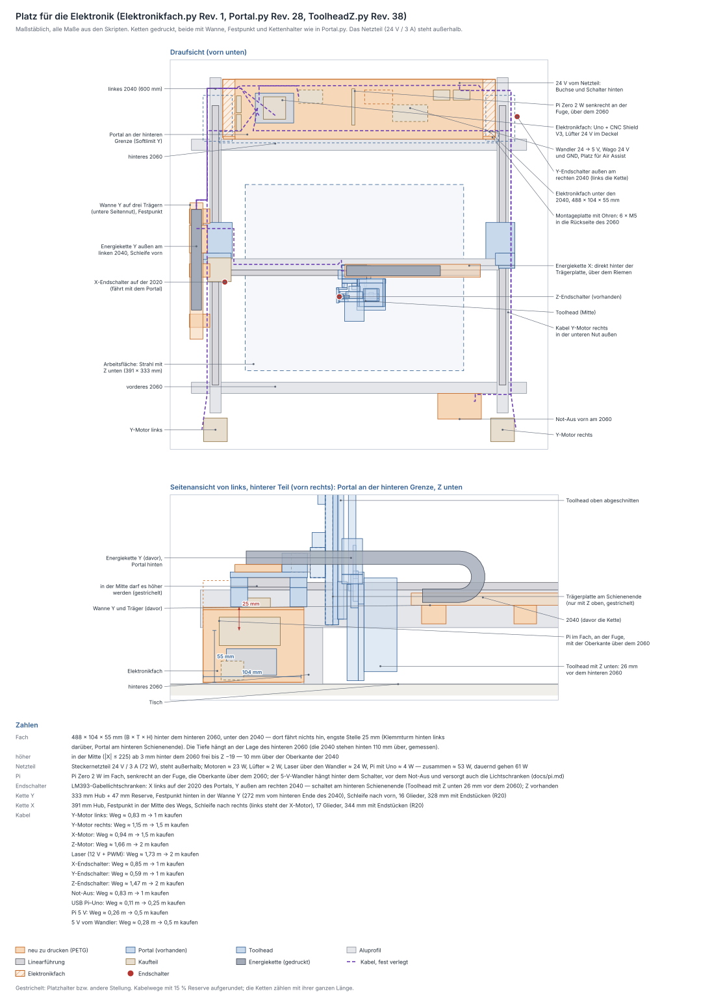
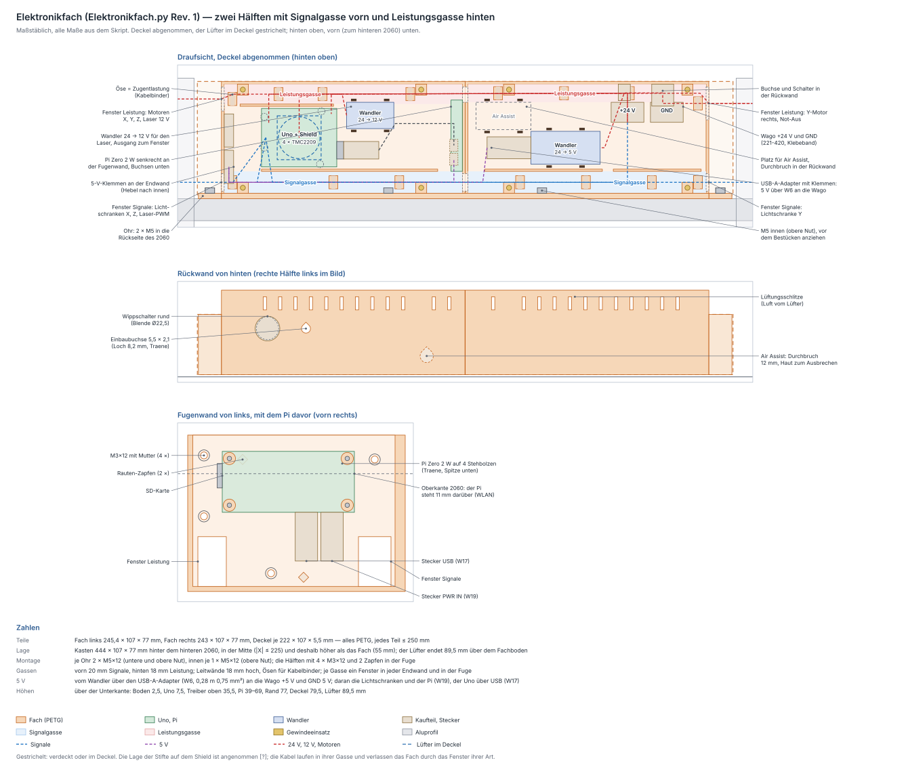
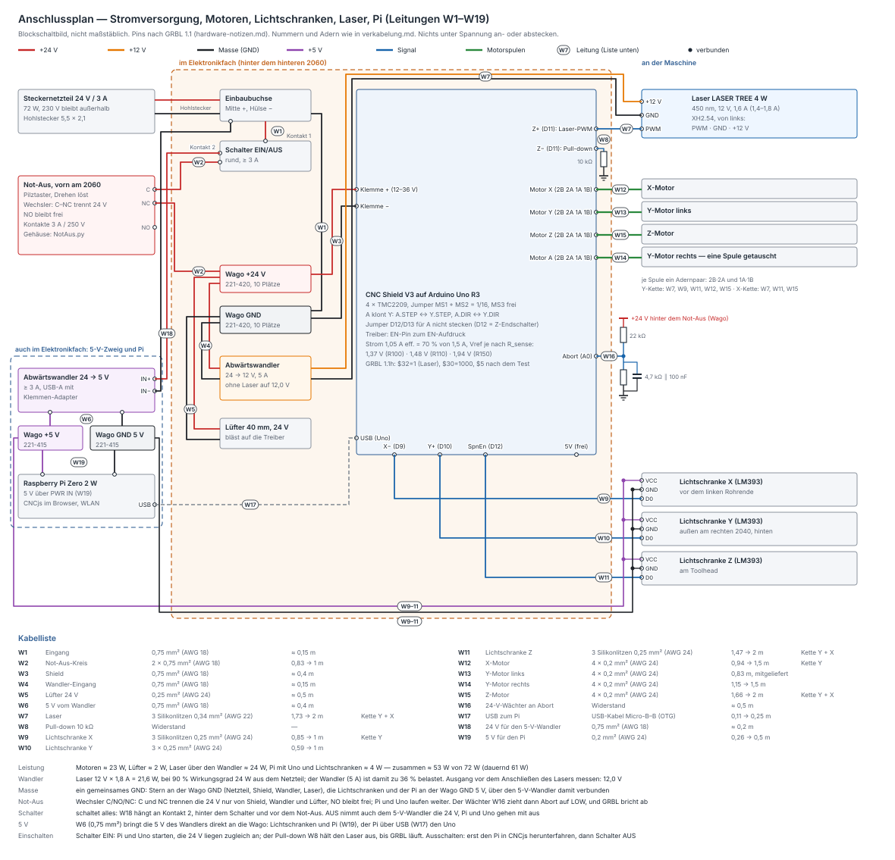

# Elektronik — Platz, Elektronikfach, Endschalter, Kabel

Wohin mit Steuerung, Netzteil, Endschaltern und Kabeln. Der Platz ist
gerechnet: `python3 tools/portal_check.py`, Abschnitt 16. Das
[Elektronikfach](#elektronikfach) erzeugt
`fusion/Elektronikfach/Elektronikfach.py`, geprüft mit
`python3 tools/elektronik_check.py`. Die Zeichnung erzeugt
`python3 tools/elektronik_zeichnen.py`; sie gibt auch die Kabellängen und
die Spannungsfälle der [Litzen](#litzen) aus; das Fach im Einzelnen
`python3 tools/elektronikfach_zeichnen.py`, den
[Anschlussplan](#anschlussplan) `python3 tools/anschluss_zeichnen.py`.
**Stand:** Das Elektronikfach (Rev. 1, 2026-10-13) ersetzt das
Elektronik-Gehäuse (Elektronik.py Rev. 4) und den Pi-Halter: Steuerung, Pi,
beide Wandler und die Verteilung liegen in einem Fach über die ganze
Breite, gezeichnet und geprüft, die STL sind fertig. Es übernimmt die
Angaben vom Aufbau vom 2026-09-27 (Stapelhöhe, Wandler 12 V / 5 A,
Wago-Bestand, 110 mm Überstand der 2040 hinten, Laseranschluss). Die
Endschalter sind gebaut ([endschalter.md](endschalter.md)). Die
Energieketten sind gedruckt, beide mit Wanne, Festpunkt und Halter, dazu
der Kabelweg zwischen ihnen ([energiekette.md](energiekette.md)). **Die
ganze Verdrahtung** — Kabelliste, Anschlussliste, Klemmen, Schritt für
Schritt und Inbetriebnahme — steht in [verkabelung.md](verkabelung.md).
Pinbelegung, Treiber und Jumper stehen in
[hardware-notizen.md, Elektronik](hardware-notizen.md#elektronik). Ohne PC
bedient wird die Maschine über einen Pi mit CNCjs ([pi.md](pi.md)), der im
Fach mitsitzt.



## Wohin: das Fach hinter dem hinteren 2060

Hinter dem hinteren 2060 stehen die 2040 frei nach hinten über. Darunter,
zwischen Tisch und 2040, fährt nichts hin:

| | |
|---|---|
| Fach | **488 × 104 × 55 mm** (Breite × Tiefe × Höhe) |
| Lage | zwischen den Innenseiten der 2040, von 3 mm hinter dem 2060 bis 3 mm vor ihr hinteres Ende, von 2 mm über dem Tisch bis 3 mm unter die 2040 |
| engste Stelle | **25 mm**: der hintere linke Klemmturm des Y-Schlittens über dem Fach, wenn das Portal am hinteren Schienenende steht (bis Portal Rev. 24: 23 mm) |
| höher geht es | in der Mitte (\|X\| ≤ 225 mm) gleich hinter dem 2060 bis 10 mm über die Oberkante der 2040 (108 mm über dem Fachboden) |

Nach hinten begrenzt das **Schienenende** den Y-Weg, nicht das 2060: Dort
steht der Toolhead mit Z unten noch 26 mm vor dem hinteren 2060, die
Trägerplatte 23 mm vor der Montageplatte. Die Prüfung fährt Portal und
Toolhead über den ganzen Y-Weg bis an das Schienenende, dazu über X und Z,
und lässt nur Stellungen gelten, in denen der Toolhead kein 2060
durchdringt.

Die Tiefe folgt aus dem Überstand der 2040 hinter dem hinteren 2060:
**110 mm** `[v]` (bis Rev. 1 waren 145 mm angenommen), die 2060 liegen damit
**435 mm** Mitte zu Mitte auseinander. Das Elektronikfach braucht mit seiner
Montageplatte 107 mm ab der Rückseite des 2060 und endet 3 mm vor dem Ende
der 2040.

## Was hinein kommt

| Teil | Platz | Stand |
|---|---|---|
| Steuerung: Uno R3 + CNC Shield V3 + 4 × TMC2209 | im [Elektronikfach](#elektronikfach) links, 24-V-Lüfter im linken Deckel über den Treibern; USB nach rechts zum Pi | gezeichnet |
| Netzteil | **Steckernetzteil GIDEALED 24 V / 3 A (72 W)**, steht außerhalb — ins Fach kommt nur seine 24-V-Leitung | vorhanden |
| 24-V-Eingang | in der Rückwand der rechten Hälfte: Einbaubuchse 5,5 × 2,1 mm (M8) und runder Wippschalter (Blende Ø22,5); an der Buchse zweigt vor dem Schalter W18 zum 5-V-Wandler ab | gezeichnet |
| Verteiler | Abwärtswandler 24 → 12 V / 5 A für den Laser (43 × 24 × 20 mm) links hinten neben dem Uno; Wago +24 V und GND (221-420) rechts hinten vor Buchse und Schalter; Wago +5 V und GND 5 V (221-415) senkrecht an der linken Endwand, gespeist vom 5-V-Wandler über W6 | gezeichnet; Wandler und drei Wago vorhanden, die zweite 221-415 neu |
| Not-Aus | vorn am vorderen 2060 im eigenen Gehäuse ([notaus.md](notaus.md)); Pilztaster mit Wechsler, C–NC in der 24-V-Leitung — schaltet Laser und Motoren ab, der 24-V-Wächter meldet es an GRBL | vorhanden, Gehäuse gezeichnet |
| Pi: Raspberry Pi Zero 2 W mit CNCjs, 5-V-Wandler 24 → 5 V | Pi senkrecht an der Fugenwand der linken Hälfte, der Wandler rechts vorn ([pi.md](pi.md#im-elektronikfach)); hängt vor Schalter und Not-Aus an der Buchse und versorgt über USB den Uno | gezeichnet |

Das Fach hängt an der **Rückseite des hinteren 2060** mit 6 × M5 in
Hammermuttern (je Ohr 2 in der unteren und oberen Nut, innen je 1 in der
oberen), wie die übrigen Halter — der Tisch trägt nichts, die Maschine
steht weiter nur auf den 2060.

## Elektronikfach



`fusion/Elektronikfach/Elektronikfach.py`, Rev. 1. Vier Druckteile aus
PETG, jedes höchstens 250 mm (Bambu Lab A1):

| Teil | Druck | Bauraum |
|---|---|---|
| Fach_links: Kasten links mit Ohr | auf dem Boden stehend | 245,4 × 107 × 77 mm |
| Fach_rechts: Kasten rechts mit Ohr | auf dem Boden stehend | 243 × 107 × 77 mm |
| Deckel_links, mit dem Lüfter | Oberseite aufs Bett | 222 × 107 × 5,5 mm |
| Deckel_rechts, mit Lüftungsschlitzen | Oberseite aufs Bett | 222 × 107 × 5,5 mm |

Fertige STL in Drucklage: `stl/Elektronikfach_Fach_links_r1.stl`,
`_Fach_rechts_r1`, `_Deckel_links_r1`, `_Deckel_rechts_r1`
(`python3 tools/stl_export.py Elektronikfach`, braucht
`pip install manifold3d`). Keine Stützen: Die Fenster haben ein
45°-Dach, waagerechte Löcher sind Tränen, die Dome haben eine
45°-Stütze, die Stehbolzen des Pi sind Tränen mit der Spitze unten.

**Aufbau:** Der Kasten ist 444 × 107 × 77 mm (ohne die Ohren), seine
Montageplatte (5 mm) liegt an der Rückseite des hinteren 2060. Die zwei
Hälften stoßen in der Mitte mit je einer Fugenwand aneinander: 4 × M3×12
mit Mutter, 2 Rauten-Zapfen richten sie aus. Die Kabel laufen nach Art
getrennt in zwei Gassen längs des Fachs: die **Signalgasse** vorn an der
Montageplatte (20 mm breit: Lichtschranken, 5 V, Wächter), die
**Leistungsgasse** hinten an der Rückwand (16,5–18 mm: 24 V, 12 V zum
Laser, Motoren). Leitwände, 18 mm hoch, trennen sie von den Geräten.
Ösen am Boden nehmen Kabelbinder 2,5 mm auf; die erste hinter jedem
Fenster ist die Zugentlastung. Jede Gasse hat ein Fenster in beiden
Endwänden und eins in der Fuge.

* **Links:** der Uno mit Shield auf vier Stehbolzen (4 × M3×8
  selbstschneidend, vor dem Shield), die Endschalter-Stifte links, USB
  rechts zum Pi. Darüber im linken Deckel der 24-V-Lüfter (4 × M3×16 mit
  Mutter, bläst nach unten). Hinten neben dem Uno der 12-V-Wandler,
  Ausgang nach links, zwei Kabelbinder durch den Boden. Senkrecht an der
  linken Endwand über dem Fenster Leistung die Wago +5 V und GND 5 V
  (Klebeband, Drähte von unten, Hebel nach innen). An der Fugenwand
  senkrecht der Pi ([pi.md](pi.md#im-elektronikfach)).
* **Rechts:** vorn der 5-V-Wandler mit einem USB-A-Adapter mit
  Schraubklemmen `[?]` in seiner Buchse (W6 an die Wago +5 V), zwei
  Kabelbinder durch den Boden. Hinten die Wago +24 V und GND (Klebeband,
  Drähte von vorn, Hebel oben), dahinter in der Rückwand Einbaubuchse und
  Schalter. Platz für ein Air-Assist-Modul bis 50 × 25 mm an der Fuge,
  dahinter ein Durchbruch Ø12 in der Rückwand mit 0,6 mm Haut zum
  Ausbrechen.
* **Deckel:** je Hälfte einer, mit einer Lippe innen an den Wänden und
  4 × M3×8 in Messing-Einsätzen M3 der Dome. Der Lüfter hängt über einen
  Dupont-Stecker an W5, damit der linke Deckel abgeht. Dazu
  Lüftungsschlitze oben in der Rückwand.

Höhen über der Unterkante: Boden 2,5, Uno 7,5, Treiber oben 35,5, Pi
39–69, Rand 77, Deckel 79,5, Lüfter 89,5 mm.

**Warum es passt:** Außen bleibt das Fach 55 mm hoch, bis 3 mm unter die
2040. Darüber ragen nur Kasten, Deckel und Lüfter, und nur in der Mitte
(|X| ≤ 225 mm), wo nichts so tief herunterfährt. Die Ohren liegen unter
den 2040. `tools/elektronik_check.py` fährt Portal und Toolhead über den
ganzen Weg dagegen; zum hinteren linken Klemmturm bleiben 15 mm.

**Montage:**

1. Die ausgeblendeten Bohrlehren (Uno, Pi, Fuge) drucken und Uno und Pi
   darauflegen: Alle Löcher müssen fluchten. Erst dann das Fach drucken.
2. 8 Messing-Einsätze M3 in die Dome einschmelzen.
3. Die Hälften mit 4 × M3×12 und Muttern verbinden, die Zapfen richten
   sie aus.
4. Leer an die Rückseite des hinteren 2060: 6 Hammermuttern, je Ohr
   2 × M5×12 (untere und obere Nut), innen je 1 × M5×12 (obere Nut). Der
   Inbus kommt nur von hinten dran, also vor dem Bestücken anziehen.
5. Bestücken und verdrahten nach
   [verkabelung.md](verkabelung.md#schritt-für-schritt): Uno vor dem
   Shield, Wandler, Wago, Buchse und Schalter, Pi. Den 12-V-Wandler
   **ohne Laser** auf 12,0 V stellen.
6. Lüfter mit 4 × M3×16 und Muttern auf den linken Deckel, **blasend nach
   unten** (Pfeil am Lüfterrahmen), Stecker an W5. Deckel aufsetzen,
   4 × M3×8 je Seite.

**Gemessen `[v]` (2026-09-27):** die Höhe von Uno, Shield und Treibern mit
Kühlkörper, **28 mm** ab Unterseite Uno; das Lochbild des Uno stimmt mit
der Bohrlehre; der Wandler, 43 × 24 × 20 mm.

**Schalter:** rund, die Blende außen **22,5 mm** `[v]` (Angabe
2026-10-09). Das Einbauloch ist **Ø20,2** angenommen `[?]`, bei dieser
Blende üblich 20 mm. Die Rückwand ist um das Loch innen auf 1,6 mm
verdünnt, damit die Rastnasen greifen. Oben endet das Loch 0,6 mm über dem
Kreis flach. So druckt es in der senkrechten Wand ohne Überhang, und die
Blende deckt die Kappe. Miss vor dem Druck den Körper des Schalters: Ist
er dicker als 20 mm, `schalter_d` anpassen.

**Nicht gemessen `[w]`/`[?]`:** die Einbaubuchse (Loch 8,2 für M8), der
USB-A-Adapter, die Stecker, das Lochbild des Pi und die Wago-Klemmen nach
Datenblatt: 221-415 30,2 × 18,8 × 8,6 mm, 221-420 (10 Leiter, zwei Reihen)
29,8 × 18,3 × 15,8 mm (Breite × Tiefe × Höhe, je die größere
Händlerangabe).

| Parameter | Wert | Wirkung |
|---|---|---|
| `geh_x1` / `geh_h` | 222 / 77 mm | halbe Breite und Höhe des Kastens |
| `gasse_vorn` / `gasse_hinten_r` / `leitwand_h` | 20 / 16,5 / 18 mm | Signalgasse, Leistungsgasse rechts, Höhe der Leitwände |
| `fenster_pow_l` / `fenster_pow_r` | 22 / 30 mm | Breite der Fenster Leistung links (darüber die 5-V-Klemmen) und rechts |
| `stapel_h` | 28 mm `[v]` | Höhe Uno + Shield + Treiber |
| `w12_x0` / `w5_x0` | −108 / 60 mm | Ausgangskante des 12-V-Wandlers, Kante des 5-V-Wandlers mit der USB-A-Buchse |
| `wago24_x0` | 133 mm | linke Kante der Wago 24 V |
| `buchse_x` / `buchse_d` | 145 / 8,2 mm | Einbaubuchse: Mitte, Loch |
| `schalter_x` / `schalter_d` / `schalter_blende_d` / `schalter_wand` | 180 / 20,2 `[?]` / 22,5 `[v]` / 1,6 mm | runder Wippschalter: Mitte, Einbauloch, Blende außen, Wand am Loch |
| `m5_innen_x` | 70 mm | innere M5 in der oberen Nut, so weit von der Mitte |

## Leistung: Reichen 72 W?

Ja, mit Reserve: Alles zusammen braucht **≈ 53 W**, das Netzteil gibt
dauernd 61 W ab.

| Verbraucher | Leistung |
|---|---|
| 4 × NEMA 17 (Stepperonline, 1,5 A) an TMC2209, je 1,05 A eingestellt | ≈ 23 W — je Motor 2 Phasen × (1,05 A)² × 2,3 Ω plus 0,6 W im Treiber; 2,3 Ω laut Datenblatt des 17HE15-1504S `[w]` |
| Lüfter 40 mm | ≈ 2 W |
| Laser LASER TREE 4 W: 12 V × 1,8 A (obere Angabe) = 21,6 W, über den Wandler (90 %) | ≈ 24 W |
| Pi, Uno, Treiberlogik und 3 Lichtschranken: zusammen 755 mA aus 5 V, über den 5-V-Wandler des Pi (85 %) | ≈ 4,4 W |
| **zusammen** | **≈ 53 W**, also ≈ 2,2 A auf der 24-V-Leitung |
| Netzteil, dauernd (85 % von 72 W) | 61 W — **≈ 8 W Reserve** |

Ein Chopper-Treiber zieht aus dem Netzteil nicht die Spulenströme, sondern
nur die Verluste in Wicklung und Treiber, dazu die mechanische Leistung —
bei einem Laser-Portal wenige Watt. Deshalb reichen für vier Motoren rund
23 W.

Wird das Steckernetzteil überlastet, schaltet es ab, und mit ihm gehen auch
Pi und Uno aus: Der Auftrag bricht mitten im Werkstück ab, und die SD-Karte
des Pi kann Schaden nehmen. Die Reserve ist dafür da. Ein stärkerer Laser (10 W Lichtleistung und mehr, meist
60 W Aufnahme `[w]`) bräuchte ein größeres 24-V-Netzteil — nicht über 28 V,
das vertragen die TMC2209 nicht.

## Endschalter

Alle drei als **LM393-Gabellichtschranke**, wie Z (Maße in
[hardware-notizen.md](hardware-notizen.md#endschalter)): 5 V direkt an die
Eingänge des Shields, ohne Pegelwandler. Der induktive LJ12A3 ginge an X
und Y auch, bräuchte aber 6–36 V und einen Optokoppler.

| Achse | wo | Fahne | Referenz |
|---|---|---|---|
| X | vor dem linken Ende des Portalrohrs (der 2020), Block an der X-Schiene; fährt mit dem Portal | Klammer unten an der Trägerplatte | nach links |
| Y | außen am **rechten** 2040, 35 mm hinter dem hinteren 2060, untere Nut | Klammer an der rechten Schlittenplatte | nach hinten |
| Z | am Toolhead (vorhanden) | Schaltfahne (vorhanden) | nach oben |

**Y rechts, weil links die Y-Kette läuft:** Die Fahne hinge außen neben dem
Schlitten, genau dort, wo links die Kette neben dem 2040 liegt, und der
obere Trum der Kette liegt über ihr. Rechts ist die Seite frei. Das Kabel
verlässt das Elektronikfach rechts und läuft in der unteren Nut außen am
rechten 2040 nach hinten.

**X links, vor dem Rohr:** Am linken Wegende steht der X-Motor 3 mm neben
der Trägerplatte, und der X-Riemen läuft vom Ritzel zum Riemenhalter. Die
Lichtschranke sitzt deshalb nicht am Motor, sondern auf einem Block vor
dem linken Rohrende, der an das Ende der X-Schiene stößt. Die Fahne hängt
an einer Klammer unten an der Trägerplatte. Halter, Fahnen, Montage und
Einstellen: [endschalter.md](endschalter.md).

Die Näherungssensoren (LJ12A3) brauchst du dafür nicht, sie sind die
Reserve.

**Warum Y hinten am Schienenende referenziert:** Seit die 2060 435 mm
auseinander liegen (gemessen), kommt der Toolhead mit Z unten nicht mehr an
das hintere 2060 — am hinteren Schienenende steht er noch 26 mm davor. Nach
hinten begrenzen also die Y-Wagen, die dort bündig mit dem Schienenende
stehen. Der Schalter soll 3 mm davor schalten: Die Wagen dürfen nicht über
das Ende hinaus, sonst fallen Kugeln heraus. Der Weg der Softlimits reicht
dann vom Schaltpunkt bis 3 mm vor das vordere 2060 (Z unten): 333 mm
zwischen Schienenende und vorderem 2060 (227 hinter und 106 vor der Mitte),
davon gehen Schaltabstand und Rückzug ab.

Die GRBL-Einstellungen mit diesen Wegen (`$130`–`$132`, gerechnet aus den
Schaltpunkten) und den Test der Lichtschranken mit `?` und `$5` beschreibt
[verkabelung.md](verkabelung.md#grbl-einstellungen); angeschlossen werden
sie nach [verkabelung.md](verkabelung.md#4-5-v-und-lichtschranken-w6-w9w11).

## Kabel

**Fest verlegt** an den Nuten: an den 2040 in den
[Kabelhaltern](kabelhalter.md) unter der unteren Außennut (links fünf,
rechts vier), in der oberen Nut des Portalrohrs mit Nutabdeckungen oder
Clips:

* links aus dem Elektronikfach (Fenster der linken Endwand), unter dem
  linken 2040 durch an die **untere Nut
  außen am linken 2040** — dort entlang zum linken Y-Motor (an den drei
  Trägern der Wanne Y in den Kabelhaltern unter ihrer Wand durch) und bis
  hinter die Wanne Y, dort hinein zum Festpunkt der Y-Kette;
* auf dem linken Y-Schlitten vom Kettenhalter Y hinter Stirnblock und
  Rückwand nach innen, in die **obere Nut des Portalrohrs** und darin zum
  Kabelflügel am Festpunkt der X-Kette; das fährt alles mit dem Portal;
* rechts aus dem Elektronikfach (Fenster der rechten Endwand), unter dem
  rechten 2040 durch in dessen **untere Nut außen**: nach vorn zum rechten
  Y-Motor und zum Not-Aus, nach hinten zum Y-Endschalter.
* im Fach bleiben die Leitungen zum Pi und zum 5-V-Wandler (W17–W19) und
  alles zwischen Buchse, Wago, Wandlern und Shield. Welche Leitung durch
  welches Fenster geht, zeigt das Bild in
  [verkabelung.md](verkabelung.md#schritt-für-schritt).
* Vorn belegt der [Y-Motorhalter](y-motorhalter.md) die letzten 30 mm der
  unteren Nuten beider Seitenflächen (Nutensteine), dahinter sitzen am
  vorderen 2060 die Winkel, die die 2040 halten. Das Motorkabel verlässt die
  Nut vor dem Winkel und läuft außen an Winkel und Schenkel zum Motor. Am
  hinteren 2060 sitzen ebenfalls Winkel (8 je Kreuzung), dort genauso.

**Bewegt** in zwei Energieketten:

| | Y-Kette | X-Kette |
|---|---|---|
| wo | außen am linken 2040, 3 mm neben der Schlittenplatte (die steht bis 12 mm über das 2040 hinaus) | direkt hinter der Trägerplatte, in einer Wanne über Portalrohr und X-Riemen |
| Hub | 333 mm, dazu 47 mm Reserve nach vorn | 391 mm |
| Festpunkt | hinten in der Wanne Y: Endstück 180 auf Wanne und Träger, 272 mm vom hinteren Ende des 2040 | Mitte des X-Wegs: Endstück 180 auf Wanne und Stütze |
| Schleife | nach vorn; die Wanne hängt an drei Trägern in der unteren Seitennut außen am 2040 | nach rechts — links stünde am Wegende der X-Motor darin |
| bewegtes Ende | Kettenhalter Y auf der Platte des linken Y-Schlittens, hinter dem Stirnblock | Kettenhalter hinten an der Trägerplatte, über dem Riemenhalter |
| Länge (R 20, mit Anfangs- und Endstück) | 16 Glieder, 328 mm (Arbeitsweg + Reserve) | 17 Glieder, 344 mm |
| darin | X- und Z-Motor, Laser, X- und Z-Endschalter: 17 Adern, 34 % gefüllt | Z-Motor, Laser, Z-Endschalter: 10 Adern, 21 % gefüllt |
| Stand | konstruiert (Portal Rev. 21), [energiekette.md](energiekette.md#y-kette) | konstruiert, [energiekette.md](energiekette.md) |

Beide Ketten sind **gedruckt** (Angabe vom 2026-10-01), nach dem Modell
„Energiekette“ von lingnau.florian: außen 18 × 14 mm, innen 10 × 8,8 mm,
Teilung 16, Biegeradius R 20: Um 180° gebogen ist die Schleife außen
50 mm hoch, 4 Gelenke knicken im Bogen (gemessen am 2026-10-02). Beide
Ketten sind gleich groß. Die
gekauften Ketten mit 10 × 20 mm innen und 15 × 27 mm außen braucht es
nicht mehr. Gezeichnet sind beide so, wie `Portal.py` sie baut, in der
Seitenansicht die Y-Kette mit dem Portal am hinteren Schienenende.

Die Längen bis zum Gerät (Weg wie gezeichnet, 15 % Reserve, aufgerundet)
stehen mit Litze, Weg und Kette jeder Leitung in der Kabelliste von
[verkabelung.md](verkabelung.md#leitungen); `tools/elektronik_zeichnen.py`
gibt sie auch beim Zeichnen aus.

In den Ketten nur **Einzellitzen aus Silikon**, keine Mantelleitungen,
kein Massivdraht und keine starren Flachbandkabel: Für Mantelleitungen ist
R 20 zu eng ([energiekette.md](energiekette.md#litzen-in-der-kette)). Die üblichen 1-m-Motorkabel
reichen also nur für den linken Y-Motor. Der Laser bekommt ein eigenes 3-adriges
Kabel mit XH-Stecker ([Einkaufsliste](#einkaufsliste-vorschlag)).

### Litzen

Kupfer, feindrähtig. Der Querschnitt folgt aus Strom und Länge und aus dem,
was Stecker und Klemmen nehmen `[w]`: XH-Crimpkontakt 0,08–0,34 mm²
(AWG 28–22), PH 0,05–0,22 mm² (AWG 30–24), Dupont AWG 28–22, Wago 221
feindrähtig 0,14–4 mm². Gerechnet in `tools/elektronik_zeichnen.py`, geprüft
in `tools/elektronik_check.py` (Abschnitt 15), jeweils am längsten Weg:

| Leitung | Strom | Litze | warum |
|---|---|---|---|
| 24 V: Buchse → Schalter → Not-Aus → Wago +24 V, Buchse − → Wago GND, Wago → Shield und Wandler | bis 3 A (Netzteil) | **0,75 mm² (AWG 18)**, rot und schwarz | belastbar 6 A (VDE 0298-4, flexible Leitung); 0,5 mm² hätte genau die 3 A. Not-Aus 1 m hin und zurück: 0,14 V bei 3 A |
| 24 V zum 5-V-Wandler (W18): Buchse → Wandler | 0,19 A, bei einem Kurzschluss im Wandler bis 3 A | **0,75 mm²**, rot und schwarz | wie die 24-V-Leitung, weil sie vor Schalter und Not-Aus hängt: Das Netzteil begrenzt erst bei 3 A. 0,2 m: unter 0,01 V |
| 5 V (W6, W19) und USB (W17) | W6 0,76 A (alles an 5 V), W19 0,68 A (Pi, über ihn Uno und Treiberlogik), W17 0,08 A (Uno, Treiberlogik) | W6 **0,75 mm²**; W19 fertiges Micro-USB-Kabel mit Stromadern mindestens AWG 24; W17 fertiges USB-Kabel | W6 0,33 m: 0,01 V. W6 + W19 mit AWG 24: 0,07 V; mit AWG 28 blieben am Pi 4,84 V, unter ≈ 4,63 V meldet er Unterspannung `[w]`, und die Wago hält AWG 28 nicht sicher. W17 0,25 m: 0,01 V mit AWG 28 |
| Laser: +12 V, GND, PWM | 1,8 A | **3 × 0,34 mm² (AWG 22)** | dicker passt nicht in den XH-Kontakt am Laser; 2 m: 0,37 V = 3 % von 12 V |
| Motoren | 1,05 A je Spule | **4 × AWG 24 (0,2 mm²)** | dicker passt nicht in den PH-Kontakt am Motor; Z-Motor, 2 m: 0,35 Ω = 15 % der Wicklung. Fertige Motorkabel mit AWG 26 gehen auch (24 %) |
| Endschalter: 5 V, GND, Signal | ≈ 20 mA | **3 × 0,25 mm² (AWG 24)** | 0,14 mm² ist das Minimum der Wago (AWG 26 hat nur 0,13); in den Dupont-Kontakt passen bis 0,34 |
| Lüfter | < 0,1 A | seine eigene Litze, über einen Dupont-Stecker verlängert mit W5 (0,25 mm²) | |

* In Schraubklemmen (Shield, Wandler, USB-A-Adapter) mit **Aderendhülse**,
  in die Wago ohne.
* In den Ketten nur Einzellitzen aus Silikon, die Motorkabel nur als lose
  Adern ohne Schlauch. Die gedruckten Ketten biegen mit R 20, dafür sind
  Mantelleitungen zu steif.
* Die Y-Kette trägt fünf Leitungen (X- und Z-Motor, Laser, X- und
  Z-Endschalter) mit 17 Adern, die X-Kette drei mit 10 Adern. Innen sind
  10 × 8,8 mm frei. Die Adern füllen das zu 34 und 21 %, höchstens 60 %
  sind gut `[w]` (Prüfung in `tools/elektronik_check.py`).

## Anschlussplan



Kein 230 V in der Maschine: Das Steckernetzteil liefert 24 V, am Rahmen muss
nichts geerdet und keine Netzklemme abgedeckt werden.

Die Verdrahtung Leitung für Leitung (W1–W19), die Belegung von Wago-Klemmen
und Shield, die Reihenfolge beim Anschließen und die Inbetriebnahme mit
Tests stehen in [verkabelung.md](verkabelung.md). Plan und Tabellen
entstehen aus derselben Kabelliste (`tools/verkabelung.py`).

Die 24 V teilen sich an der Einbaubuchse in zwei Zweige:

```
Netzteil ── Buchse ─┬─ W1 ── Schalter ── W2 ── Not-Aus ── W2 ── Wago +24 V: Shield, Wandler 12 V, Lüfter
                    └─ W18 ── 5-V-Wandler ── W6 ── Wago +5 V ─┬─ W19 ── Pi ── W17 (USB) ── Uno
                                                              └─ W9–W11: Lichtschranken
```

* **Zweig mit Schalter und Not-Aus:** Shield (Motoren), Abwärtswandler
  12 V (Laser) und Lüfter. Fehlen hier die 24 V, meldet der 24-V-Wächter
  (W16) das an GRBL, und GRBL bricht ab.
* **Zweig zum Pi:** W18 ist an der Buchse angelötet, **vor** Schalter und
  Not-Aus. Der 5-V-Wandler im Fach gibt seine 5 V über den USB-A-Adapter
  und W6 an die Wago +5 V. Von dort gehen W19 in **PWR IN** des Pi und die
  drei Lichtschranken ab. Über W17 an der Buchse **USB** bekommt der Uno
  Daten und 5 V vom Pi; der Stift 5V am Shield bleibt frei. Pi und Uno
  laufen also, sobald das Netzteil steckt. Einschalten heißt: Netzteil einstecken, dann den Schalter
  ([pi.md, Strom](pi.md#strom)).
* **Masse:** Buchse − an die Wago GND (W1) und an IN− des 5-V-Wandlers
  (W18). Dessen USB-Masse geht über W6 an die Wago GND 5 V, an der
  Lichtschranken und Pi hängen (gemeinsame Masse im Wandler `[w]`,
  [noch offen](verkabelung.md#noch-offen)); über W3 hängt das Shield, über
  USB der Uno daran. Alle haben so dieselbe Masse.

Zu den Teilen:

* **Abwärtswandler:** vorhanden, **12 V / 5 A**, 43 × 24 × 20 mm `[v]`.
  Der Laser zieht höchstens 1,8 A, der Wandler ist damit zu 36 % belastet —
  reichlich Luft.
* **Treiber:** GERUI TMC2209 V2.0 mit Kühlkörper (5 Stück: 4 + Ersatz),
  standalone, 1/16 über MS1 + MS2. Strom am Vref-Poti, Ziel **1,05 A eff.**
  = 70 % des Nennstroms 1,5 A. Vref hängt vom Messwiderstand ab: **1,37 V**
  bei R100, **1,48 V** bei R110, **1,94 V** bei R150. Ein Aufdruck R110 ist
  auf den Modulen nicht zu finden — deshalb **mit 1,37 V anfangen**: Das
  gibt bei jedem der drei höchstens 1,05 A. Rechnung und Vorgehen in
  [hardware-notizen.md](hardware-notizen.md#treiber-und-versorgung).
* **5-V-Wandler:** 24 → 5 V, 63 × 30 mm `[v]`, mindestens 3 A, Eingang
  mit Schraubklemmen, Ausgang USB-A, darin ein Adapter mit Schraubklemmen
  `[?]`. Er liefert höchstens 0,76 A und ist
  damit zu einem Viertel belastet.
* **Sicherung:** braucht es nicht, auch nicht im Zweig zum Pi. Das Netzteil
  begrenzt den Strom selbst.

## Einkaufsliste (Vorschlag)

| Menge | Teil | wofür |
|---|---|---|
| 1 | Abwärtswandler 24 → 12 V / 5 A, 43 × 24 × 20 mm | vorhanden |
| 1 | Einbaubuchse 5,5 × 2,1 mm mit M8-Gewinde (Fach: Loch 8,2) | 24-V-Eingang |
| 1 | Wippschalter rund (Blende Ø22,5, Einbauloch Ø20), ≥ 3 A | EIN/AUS |
| 1 | Lüfter 40 × 40 × 10 mm, 24 V | über den Treibern |
| 2 | Energiekette, gedruckt: Anfangsstück und Endstück 180, 17 Glieder für X, 16 für Y (gleiche Größe) | X und Y; Wannen, Stützen, Träger und Halter: [energiekette.md](energiekette.md#verschraubung) |
| 2 + 2 | Wago 221-420 (+24 V, GND), 221-415 (+5 V, GND 5 V); 221-413 Reserve | vorhanden bis auf die zweite 221-415 |
| — | Not-Aus, Kabel, Litzen, Stecker, Aderendhülsen, Pull-down | [verkabelung.md](verkabelung.md#material-und-werkzeug) |
| 4 | Elektronikfach, PETG: `stl/Elektronikfach_*_r1.stl` | [Elektronikfach](#elektronikfach) |
| 6 + 6 | M5×12 + Hammermutter M5 (Nut 6) | Fach → Rückseite des 2060 |
| 4 + 4 | M3×12 + M3-Mutter | Fuge zwischen den Hälften |
| 8 + 8 | M3×8 + Messing-Einsatz M3 Ø5 | Deckel (je 4) |
| 4 | M3×8 | Uno → Stehbolzen |
| 4 + 4 | M3×16 + M3-Mutter | Lüfter → Deckel |
| 4 | Kabelbinder 2,5 × 200 (2,5 × 100 ist zu kurz), doppelseitiges Klebeband | beide Wandler, Wago |
| 1 | Pi Zero 2 W, 5-V-Wandler mit USB-A-Adapter, USB-Kabel, 4 × M2.5×6 | ohne PC: [pi.md](pi.md#teile) |

## Was noch fehlt

1. **Endschalter:** Halter und Fahnen für X und Y sind gezeichnet und
   geprüft ([endschalter.md](endschalter.md)). Offen sind dort vier
   Kleinigkeiten am Aufbau: Boden des Gabelschlitzes, Lötstifte, ein
   Schmiernippel am X-Wagen und der Lagerbock der hinteren Umlenkung
   ([Noch offen](endschalter.md#noch-offen)).
2. **Energieketten** (gedruckt): Beide sind konstruiert, mit Wanne,
   Festpunkt und Kettenhalter, dazu der Kabelweg in der oberen Nut des
   Rohrs ([energiekette.md](energiekette.md)). Die Schleife ist gemessen
   (R 20), der linke Schlitten ist gedruckt und wird mit der Lehre
   nachgebohrt. Offen ist dort nur noch, ob die gedruckte Kette breiter
   als 18 mm ist.
3. **Treiber:** Messwiderstand unbekannt — mit Vref 1,37 V anfangen (siehe
   [Anschlussplan](#anschlussplan)). Wer den Aufdruck der zwei kleinen
   Widerstände neben dem Chip findet (je nach Modul oben oder unten),
   stellt nach der Tabelle ein.
4. **Winkel vor dem vorderen 2060:** Sitzt ein Winkel mit einem Schenkel an
   der Seitenfläche der 2040 **vor** dem 2060, also in den 35 mm bis zur
   Stirnseite? Dort belegt der [Y-Motorhalter](y-motorhalter.md) die untere
   Nut.
5. **Verkabelung:** drei Dinge, die sich erst beim Anschließen zeigen
   ([verkabelung.md](verkabelung.md#noch-offen)).
6. **Pi:** Lochbild und Buchsen des Pi sind nach dem Maßblatt gezeichnet,
   vor dem Druck den Pi auf die Bohrlehre legen
   ([pi.md](pi.md#noch-offen)).

Geklärt (2026-09-25/26): Netzteil ist das Steckernetzteil 24 V / 3 A mit
Hohlstecker 5,5 × 2,1; der Laser ein LASER TREE 4 W mit 12 V / 1,6 A;
Lüfter 24 V; Gabellichtschranken für X und Y sind da, Näherungssensoren
als Reserve; Wago-Klemmen sind da. 2026-09-27: das CNC Shield V3 ist da;
die 2040 sitzen mit Winkeln an den 2060 (8 je Kreuzung, zwei davon in der
oberen Nut); Stapelhöhe 28 mm, Lochbild des Uno stimmt; Motoren
Stepperonline NEMA 17 (1,5 A); Treiber GERUI TMC2209 V2.0; die 2040 stehen
hinten 110 mm über; Wandler 43 × 24 × 20 mm; Wago: 1 × 221-413,
1 × 221-415, 2 × 221-420; Ketten 10 × 20 mm innen. Später am 2026-09-27:
Ketten 15 × 27 mm außen, je 1 m; Wandler 12 V / 5 A; 5 Treiber, ohne
Aufdruck R110; Motoren 17HE15-1504S (Etikett); hinteres Y-Ritzel mittig
zur 2040; die Winkel greifen in die obere Nut des 2060 und die untere der
2040; Laserstecker von links PWM · GND · +12 V. 2026-09-29: Winkel an den
Kreuzungen 20 mm; die Nuten für die Endschalterhalter sind frei; eine
Klammer an der Trägerplatte ist in Ordnung. 2026-09-30: der Not-Aus ist da,
ein Pilztaster mit Wechsler C/NO/NC und Lötfahnen, 3 A / 250 V, Gewinde
16 mm rund; er sitzt vorn. 2026-10-01: Die Energieketten werden gedruckt,
nach dem Modell „Energiekette“, auch für Y; die X-Kette liegt direkt
hinter der Trägerplatte; ein Glied dreht sich am gedruckten Teil höchstens
um 30°, gedruckt ist bisher eine Kette. Die Litzen zur X-Kette laufen in
der oberen Nut des Rohrs, am Festpunkt hält sie ein Halter mit
Kabelbindern; die Y-Kette reicht für den Arbeitsweg plus 26 mm; die Nut an
der Unterseite des linken 2040 ist belegt; die Motorkabel haben lose Adern
in einem Schlauch. 2026-10-02: Um 180° gebogen ist die Schleife außen
50 mm hoch, 4 Gelenke knicken im Bogen (die 30° waren zu klein); der linke
Y-Schlitten ist schon gedruckt; in der unteren Seitennut sitzen zwischen
den 2060 nur die Winkel.
