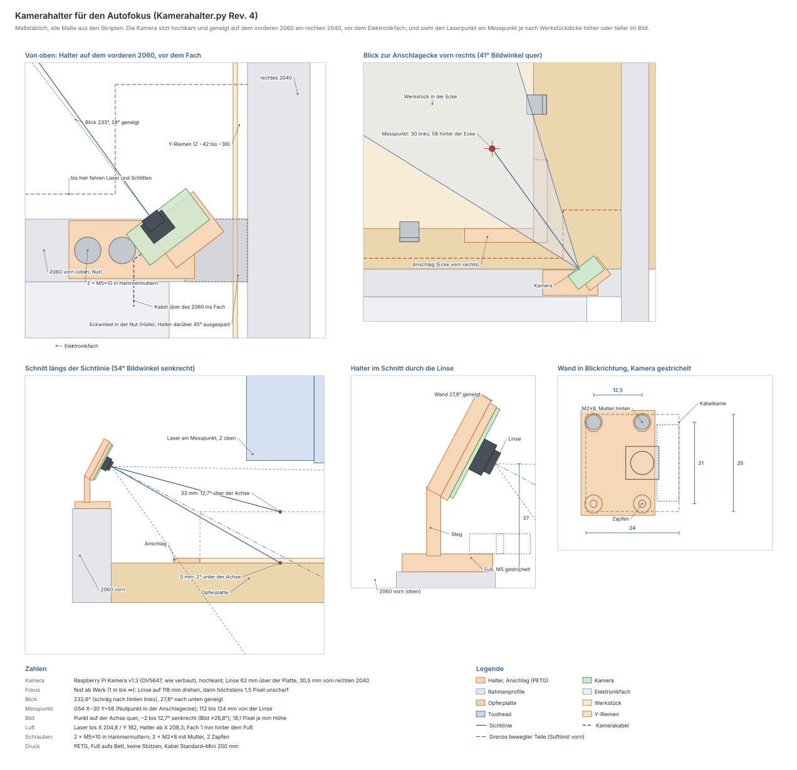

# Kamerahalter — Autofokus über Z

Eine Kamera am Pi soll den Fokus selbst einstellen. Dieser Halter trägt sie:
ein **Raspberry Pi Camera Module 3** hochkant auf dem hinteren 2060, direkt
vor dem Elektronikfach. So ist das Kabel zum Pi kurz, und der Anschlag für
die Werkstücke bleibt, wo er ist. Die Kamera schaut schräg nach vorn links
zu einem festen Messpunkt kurz innerhalb der Anschlagecke.



**Stand 2026-11-19, offen:** Das Elektronikfach steht an der Maschine
**vor dem vorderen 2060** (Elektronikfach Rev. 2), nicht hinter dem
hinteren. Die Kamera ist dort vorn rechts auf dem 2060 montiert und soll
dort bleiben. Der Anschlag ist noch nicht verbaut und soll vor die Kamera
kommen. Dieser Halter (Rev. 1) ist noch für die Lage hinten gerechnet,
deshalb meldet `kamerahalter_check.py` zwei Fehler: Das Fach steht nicht
dahinter, und das 200-mm-Kabel reicht von dort nicht bis zum Pi vorn. Lage,
Messpunkt und Kabelweg werden für vorn rechts neu geplant.

Die Maße stehen in `fusion/Kamerahalter/Kamerahalter.py` (Rev. 1). Geprüft
wird mit `python3 tools/kamerahalter_check.py`: Lage auf dem 2060, Freiraum
zu allem, was Toolhead und Portal über den ganzen Weg überstreichen, Abstand
zum Fach, Sicht zum Messpunkt für jede Dicke, Schrauben, Druck und Kabel.
Die Zeichnung erzeugt `python3 tools/kamerahalter_zeichnen.py`.

## Wie der Autofokus misst

1. Der Kopf fährt an den **Messpunkt**: 30 mm rechts und 35 mm vor der
   Innenecke des Anschlagwinkels. Mit dem Nullpunkt in der Ecke
   ([spannmittel.md](spannmittel.md#nullpunkt-einrichten-einmal)) ist das
   `G54 X30 Y-35`. Z fährt ganz nach oben.
2. Der Laser geht kurz und schwach an, wie beim Makro „Laserpunkt 1 %“, nur
   kürzer.
3. Der Strahl steht senkrecht. Der Punkt liegt deshalb bei jeder
   Werkstückdicke an derselben Stelle, nur höher oder tiefer. Die Kamera
   sieht ihn von hinten rechts: Je dicker das Werkstück, desto höher liegt
   er im Bild.
4. Ein Bild genügt. Aus der Höhe des Punkts im Bild folgt über eine einmal
   gemessene Tabelle die Höhe der Oberfläche. Z fährt auf den Fokus: Z für
   den Fokus auf der leeren Platte plus die Dicke.

Dafür muss die **Linse des Lasers fest** stehen und der Fokusabstand einmal
bestimmt sein ([hardware-notizen.md](hardware-notizen.md#fokusabstand----offen)).
Kalibriert wird einmal: leere Platte und zwei, drei Bretter bekannter Dicke
an den Messpunkt, je ein Bild. Das Skript auf dem Pi (Bild aufnehmen, Punkt
finden, Z über CNCjs fahren) ist noch nicht geschrieben.

Klares Acryl und spiegelnde Flächen lassen den Punkt durch oder spiegeln ihn
weg: Schutzfolie oder Abdeckpapier drauflassen.

## Lage

| | |
|---|---|
| Fuß | oben auf dem hinteren 2060, X −56 … −4, 2 × M5×10 in Hammermuttern der Nut bei X −50 und −10 (Maschinenkoordinaten wie `Portal.py`) |
| Kamera | hochkant, die Kabelkante zeigt nach hinten links zum Fach |
| Linse | X −40, Y −233,9, Z −47,5: **81,5 mm über der Platte**. Blick 130° gegen +X, waagerecht |
| Messpunkt | X −169,85, Y −129,8; **168 bis 185 mm** von der Linse |
| Im Bild | der Punkt 11,3° neben der Achse (Bild ±20,5°) und 8,2° (58 mm Werkstück) bis 26,5° (leere Platte) unter der Achse (Bild ±33°): mindestens 6,5° vom Rand |
| Auflösung | 20,7 Pixel je mm Höhe, also 0,05 mm je Pixel; ein Diodenlaser verzeiht etwa ±0,5–1 mm |
| Luft | vorn 3,0 mm, bis wohin die Trägerplatte am Ende des Y-Wegs fährt; oben 18 mm unter dem X-Wagen; hinten 4,4 mm zum Fach |

### Warum hochkant und waagerecht

Quer hat die Kamera senkrecht nur 41° Bildwinkel. Der Punkt wandert aber von
8° (dickes Werkstück) bis 27° (leere Platte) unter die Waagerechte. Quer
müsste die Kamera also rund 17° nach unten kippen. Dann hängen die Polster
über, und der Halter druckt nicht ohne Stützen. Hochkant sind es 66°
senkrecht, die Kamera schaut waagerecht, und die Wand steht senkrecht.

Hochkant ist die Kamera außerdem schmal genug. Zwischen der Vorderwand des
Fachs (Y −253) und der Stelle, bis zu der die Trägerplatte am Ende des
Y-Wegs fährt (−227,3, mit 3 mm Luft also −230,3), sind nur 22,7 mm frei.
Quer bräuchte die Kamera dort rund 26 mm.

### Warum Zapfen statt vier Schrauben

Die Schraubenköpfe an der Gegenkante wären der vorderste Punkt der Kamera
gewesen. Ohne sie rückt die Kamera 1,5 mm nach vorn, und das Kabel hat hinten
5,5 statt 4 mm bis zur Vorderwand des Fachs. Deshalb halten an der Kabelseite
zwei M2×8 mit Mutter, an der Gegenkante stecken zwei gedruckte Zapfen in den
Löchern.

### Warum dieser Messpunkt

Dicht an der Ecke (20/15 mm) läge der Punkt bei leerer Platte nur 4,5° vom
Bildrand. Mit 30/35 mm sind es überall mindestens 6,5°. Das Werkstück muss
den Punkt aber abdecken: Es muss von der Ecke aus mindestens etwa 35 mm nach
rechts und 40 mm nach vorn reichen. Kleinere Teile fokussierst du von Hand.

Dort, wo der Punkt liegt, und etwa 15 mm davor in Richtung Kamera darf nichts
auf dem Werkstück stehen, auch kein Niederhalter. Weiter weg läuft die
Sichtlinie hoch genug über alles hinweg.

## Teile

| Menge | Teil | wofür |
|---|---|---|
| 1 | Kamerahalter, PETG: `stl/Kamerahalter_r1.stl` (siehe [Druck](#druck)) oder aus Fusion | Halter |
| 1 | Raspberry Pi Camera Module 3, **Normalobjektiv** (nicht Wide: das stellt zwar ab 5 cm scharf, löst bei 17 cm aber nur gut halb so fein auf) | Autofokus |
| 1 | Kamerakabel **Standard–Mini** (15 auf 22 Pole), 200 mm | zum Pi Zero; das Kabel, das der Kamera beiliegt, passt nicht an den Zero |
| 2 + 2 | M5×10 Zylinderkopf + Hammermutter M5 Nut 6 | Fuß → Nut oben auf dem 2060 |
| 2 + 2 | M2×8 Zylinderkopf + Mutter M2 | Kamera an der Kabelseite |

## Druck

PETG, der Fuß liegt auf dem Bett, die Wand steht senkrecht. Keine Stützen:
Polster und Zapfen sind Tränen mit der Spitze unten, die Löcher für die M2
Tränen mit der Spitze oben. Die Muttertaschen sind Sechsecke mit einer Ecke
oben, die Rippe hat 45°. Etwa 6,5 cm³, also gut 8 g. Am Fuß sitzt die übliche
Fase von 0,4 mm gegen den Elefantenfuß.

Vorher die **Bohrlehre_Kamera** drucken: In Fusion ist sie ausgeblendet,
eine 2-mm-Platte mit Umriss, Lochbild und Linsenmitte der Kamera. Auf die
Platine legen: Passen die vier Löcher, stimmt das Lochbild der Polster. Die
Maße stammen aus dem Maßblatt (RP-008153) und sind noch nicht am Teil
gemessen.

Die STL schreibt `tools/stl_export.py` aus demselben Bauplan wie Fusion:

```sh
pip install manifold3d
python3 tools/stl_export.py Kamerahalter
```

## Montage

1. Zwei Muttern M2 von hinten in die Sechskanttaschen der Wand drücken.
2. Die Kamera mit der Kabelkante zum freien Ende (weg von den Zapfen) auf die
   Polster legen, die Zapfen in die beiden Löcher an der Gegenkante. Mit
   2 × M2×8 von vorn an der Kabelseite festschrauben. Das Kabel an der
   Kamera einstecken, die Kontakte zur Platine.
3. Zwei Hammermuttern M5 in die Nut oben auf dem hinteren 2060 setzen, bei
   X −50 und −10, das ist links vor dem Pi. Den Halter aufsetzen und mit
   2 × M5×10 festziehen, den Inbus von oben.
4. **Kabel:** Es tritt nach hinten links aus. Leg es außen an der Vorderwand
   des Fachs nach links bis neben den Fuß (X ≈ −61). Dort führst du es über
   die Oberkante der Wand unter den Deckel. Das Kabel ist etwa 0,15 mm dick,
   die Lippe des Deckels hat 0,3 mm Spiel. Innen geht es hinunter in die
   Signalgasse und darin nach rechts zur Kamerabuchse an der vorderen
   Schmalseite des Pi. Richtung wechselt das Kabel mit 45°-Falten, nicht am
   steifen Ende knicken. Der Weg ist etwa 146 mm lang, der Rest des Kabels
   liegt in der Gasse.

Sauberer wäre eine Kerbe von etwa 17 × 1 mm oben in der Vorderwand des
Fachs bei X ≈ −61. Die steht noch nicht in `Elektronikfach.py`, das ist
ohnehin ein Zwischenstand.

### Kamerakabel

Das Flachbandkabel ist isoliert: Die Leiter liegen zwischen zwei
Kunststofffolien, blank sind nur die Kontakte an den versteiften Enden, und
die stecken in den Buchsen. Andere Kabel, das Profil oder das Fach darf es
berühren.

* **Abstand zu Störern:** Es überträgt schnelle Bilddaten und ist nicht
  abgeschirmt. Nicht lang parallel zu Motorleitungen, der Laserleitung (W7,
  PWM und 12 V) oder der 24-V-Versorgung legen und nicht mit ihnen bündeln;
  quer kreuzen ist kein Problem. Im Fach gehört es deshalb in die
  Signalgasse vorn, nicht in die Leistungsgasse hinten. Außen an der
  Vorderwand liegen keine anderen Kabel; die Motorleitungen verlassen das
  Fach durch die Endwände.
* **Bildfehler** (Aussetzer, Streifen, Kamera nicht gefunden): erst den
  Sitz beider Stecker prüfen, dann, ob das Kabel doch an Motor- oder
  Laserleitungen liegt.
* **Falten statt knicken:** Richtung mit 45°-Falten wechseln, nicht
  mehrmals an derselben Stelle falten, nie direkt hinter dem steifen Ende
  knicken.
* **Kanten:** Wo das Kabel über die Oberkante der Vorderwand läuft, die
  gedruckte Kante entgraten oder ein Stück Kapton-Band darüberkleben.
* **Befestigen** mit Klebeband, nicht mit festgezogenen Kabelbindern; die
  schneiden in die Folie. Das Kabel liegt fest und bewegt sich nicht —
  dauerndes Biegen wie in einer Energiekette hält es nicht aus.
* **Einstecken nur stromlos:** Der Pi hängt vor Schalter und Not-Aus, der
  Schalter macht ihn nicht stromlos. Erst in CNCjs **Pi herunterfahren**,
  dann das Netzteil ziehen.
* **Enden:** das breite (15 Pole) an die Kamera, das schmale (22 Pole) an
  den Pi. Bügel der Buchse vorsichtig öffnen, Kabel gerade bis zum Anschlag
  einschieben, Bügel schließen; an beiden Enden zeigen die blanken Kontakte
  zur Platine. Die Kamera nur an den Kanten anfassen.

## Parameter

| Name | Wert | Wirkung |
|---|---|---|
| `blick_az` | 130° | Blickrichtung. Größer: Der Punkt rückt zur Bildmitte, die Kamera braucht in Y mehr Platz |
| `linse_x`, `linse_z` | −40 / −47,5 mm | Lage der Linse. Y rechnet das Skript: so weit vorn, dass zur Trägerplatte `luft_bau` (3 mm) bleibt |
| `mp_rechts`, `mp_vorn` | 30 / 35 mm | Messpunkt ab der Innenecke |
| `pad_h` | 2 mm | Polster: Platz für die Bauteile hinten auf der Kamera |
| `m5_links`, `m5_rechts` | −50 / −10 mm | Schrauben im Fuß; der Fuß reicht `fuss_rand` (6 mm) darüber hinaus |

Wer einen Wert ändert, lässt danach `tools/kamerahalter_check.py` laufen.
Die Prüfung meldet, ob der Punkt im Bild bleibt, die Luft reicht und das
Kabel noch Platz hat.

## Noch offen

- **Kamera** `[w]`: Maße aus dem Maßblatt. Vor dem Druck die Bohrlehre an
  die Platine halten.
- **Kamerabuchse am Pi** `[?]`: Lage nach dem Maßblatt der Zero-Reihe; sie
  bestimmt das Ende des Kabelwegs.
- **Elektronikfach**: Zwischenstand. Dazu gehört die Kerbe für das Kabel
  (oben).
- **Fokusabstand** des Lasers: noch nicht gemessen; ohne ihn weiß der
  Autofokus nicht, wohin er Z fahren soll.
- **Software** auf dem Pi: Bild mit fester Belichtung aufnehmen, den Punkt
  finden, die Höhe aus der Tabelle, Z über CNCjs. Folgt als nächster Schritt.
