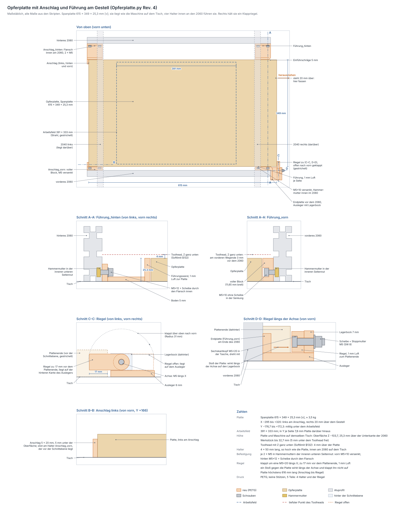

# Opferplatte, Anschlag, Führung und Riegel

Erzeugt von `fusion/Opferplatte/Opferplatte.py` (fünf Druckteile, Rev. 4).
Geprüft mit `python3 tools/opferplatte_check.py`, Zeichnung in
[opferplatte.svg](opferplatte.svg) (neu erzeugen mit
`python3 tools/opferplatte_zeichnen.py`).
Wie du das Werkstück auf der Platte spannst (Anschlag, Exzenter,
Niederhalter), steht in [spannmittel.md](spannmittel.md).

## Die Platte

Deine Opferplatte ist eine **Spanplatte 615 × 349 × 25 mm** (Angabe vom
2026-10-02, die Länge von 615 mm hast du bestätigt), gemessen **25,3 mm**
dick `[v]`, rund 3,5 kg. Gezogen wird sie **nach rechts**, sie liegt also
längs in X.

**Maschine und Platte stehen auf demselben Tisch.** Die Plattenoberfläche
liegt deshalb 25,3 mm über der Unterkante der 2060. Bis Rev. 3 stand die
Maschine im Modell auf vier Füßen, die so hoch waren wie die Platte dick
ist. An der Maschine gab es sie nie; seit Rev. 4 (2026-11-21) sind sie
auch im Modell weg. Was das für Z heißt, steht unter [Höhen](#höhen).

## Wo sie liegt

Koordinaten wie in `Portal.py`: X nach rechts, Y nach vorn, Z = 0 in der
Mitte des Portalrohrs, das Portal in der Mitte seines Wegs.

| | |
|---|---|
| X | −295 bis +320: links am Anschlag, rechts steht sie 20 mm über das Gestell, dort fasst du sie zum Herausziehen |
| Y | −176,65 bis +172,35: mittig unter dem Arbeitsfeld, zwischen den Haltern mit 1 mm Luft je Seite |
| Z | −129 bis −103,7: auf dem Tisch wie die 2060, unter den 2040 durch (34,7 mm Luft) |
| Arbeitsfeld | 391 × 333 mm (X −204 bis +187, Y −168,8 bis +164,5), so weit kommt der Strahl |
| Rand | in Y je Seite 7,85 mm Platte über das Feld hinaus, in X links 91 und rechts 133 mm |

In Y ist die Platte nur knapp 16 mm breiter als das Arbeitsfeld. Deshalb liegt
sie mittig darunter und wird von den Haltern geführt.

## Die Halter

Je ein Halter steht **innen an einem Ende der beiden 2060** auf dem Tisch,
50 mm lang (X ±250 bis ±300), also unter den Kreuzungen mit den 2040. Er
ist mit 2 × M5, 32 mm auseinander, in Hammermuttern der **inneren unteren
Seitennut** geschraubt (10 mm über dem Tisch) und reicht bis an die Platte.
Block und Wand sind so hoch wie die Platte, nicht höher.

| | |
|---|---|
| vorn: voller Block | Zwischen vorderem 2060 und Platte sind nur 11,65 mm. Die M5 sitzen deshalb versenkt: **M5×10 ohne Scheibe** in einer Senkung Ø10 von der Plattenseite, der Kopf 1,65 mm unter der Führungsfläche, 5 mm Material unter dem Kopf |
| hinten: Flansch, Boden, Wand | 52,35 mm breit: Flansch 6 mm innen am 2060 (19 mm hoch), **M5×12 mit Scheibe**; Boden 5 mm auf dem Tisch; an der Platte eine Führungswand 6 mm |
| Anschlag | an den beiden linken Haltern (`Anschlag_vorn`, `Anschlag_hinten`): 5 mm dick, greift 15 mm vor das Plattenende, 20 mm hoch, also 5,3 mm unter der Oberfläche |
| Einführschräge | an den beiden rechten Haltern (`Fuehrung_vorn`, `Fuehrung_hinten`): 5 mm unter 45°, damit die Platte beim Einschieben nicht hängen bleibt |
| Endplatte | nur an `Fuehrung_vorn`: 6 mm dick vor dem Ende des vorderen 2060, 20 mm hoch, von der Flucht der Führung bis vor das Profil. Sie verlängert die Führung, die Einführschräge sitzt an ihrem Ende |
| Ausleger | an der Endplatte: 6 mm dick flach auf dem Tisch bis X +337, darauf der Lagerbock für den Riegel (siehe unten) |

In jeder M5 stecken 5 mm in der Nut: 1,8 mm Lippe, 3,2 mm im Stein, die
Spitze bleibt 1 mm vor dem Nutgrund. Gegen einen Stoß nach links hält der
Anschlag nur über die Klemmung der beiden M5; handfest angezogen reicht das
weit.

Es sind **vier verschiedene Halter**: links mit Anschlag, rechts mit
Schräge, vorn voll, hinten mit Flansch; der vordere rechte trägt dazu
Endplatte und Ausleger.

Eine Bohrlehre gibt es nicht: Die Halter gehen in Hammermuttern, und die
Achse des Riegels ist ein einzelnes gedrucktes Loch in jedem der beiden
Teile. Gebohrt wird nichts.

## Der Riegel

Links hält der Anschlag die Platte. Rechts war sie bis Rev. 2 offen und
konnte bei einem Stoß herausrutschen. Seit Rev. 3 sitzt deshalb **vor dem
rechten Plattenende ein Klappriegel**.

Er dreht sich um eine **waagerechte M5 längs X**, also parallel zu der
Richtung, in der die Platte herausrutschen würde. Ein Stoß gegen die Platte
drückt ihn deshalb nur längs seiner Achse gegen den Lagerbock, und ein
Moment, das ihn aufklappen könnte, entsteht dabei nicht. Einen Vorreiber
mit senkrechter Achse würde die Platte dagegen selbst aufdrehen; ihn hielte
nur die Reibung.

| | |
|---|---|
| zu | die Nase liegt vor dem Plattenende: 17 mm Überdeckung in Y (16 mm, wenn die Platte hinten an der Führung liegt), 15 mm hoch, 1 mm Luft in X |
| offen | um 180° über oben nach vorn geklappt, liegt auf dem Ausleger |
| Halt | Beide Lagen hält die Schwerkraft. Geschlossen sinkt die Nase um knapp 3°, bis der Riegel hinten auf der Kante des Auslegers liegt, und bleibt dabei 5 mm über dem Tisch. Offen liegt er auf dem Ausleger. |
| Riegel | 9 × 37,5 × 15 mm, Nase 30 mm vor der Achse, um die Achse eine halbrunde Nabe Ø 15 |
| Achse | Y +185,35, Z −115 (14 mm über dem Tisch); Oberkante des Riegels 3,8 mm unter der Plattenoberfläche |
| Lagerbock | 7 mm dick (X +330 bis +337), 20 mm breit, auf dem Ausleger |
| Schraube | Sechskantschraube M5×20 (ISO 4017). Der Kopf sitzt auf der Plattenseite in einer Sechskanttasche (SW 8,3, 4 mm tief) und dreht sich mit dem Riegel. Rechts kommen Scheibe und Stoppmutter M5 (DIN 985) drauf, die Schraube steht 2 mm über. |
| Bahn frei | Ausleger und Lagerbock beginnen 2 mm vor der Führung, der offene Riegel 4,5 mm: Die Platte gleitet an allem vorbei |
| Platz | zwischen Anschlag und Riegel 616 mm: Die Platte (615 mm) hat 1 mm Spiel; eine längere ließe den Riegel nicht zu |
| Schwenkkreis | Radius 31 mm über oben, bis Z −84, rechts neben dem Ende des 2060; Gestell und Portal bleiben weit weg |

Bei einem kräftigen Stoß von 100 N biegt sich die Nase mit 5,7 MPa,
der Lagerbock mit 4,9 MPa (quer zu den Schichten), der Ausleger an der
Endplatte mit 4,9 MPa und die Endplatte am Block (am Ende des 2060) mit
4,3 MPa. Die Schraube bekommt dabei 115 N Zug, weil der Riegel um die Kante
des Lagerbocks kippen will. Das ist alles weit unter dem, was PETG trägt.

Die Stoppmutter stellst du von rechts mit einem 8er Maulschlüssel nach,
auch bei eingelegter Platte. Der Kopf in der Tasche hält dabei gegen.

## Höhen

| Z | was |
|---|---|
| −69 | Oberkante der 2060 |
| −98,2 | Unterkante des Lasers, Z am Softlimit, Laser ganz unten im Langloch |
| −99,7 | tiefster Punkt des Toolheads (Schlittenplatte), Z am Softlimit |
| **−103,7** | **Oberfläche der Platte** |
| −107,5 | Oberkante des Riegels (zu) |
| −109 | Oberkante von Anschlag und Endplatte |
| −115 | Achse des Riegels |
| −119 | innere untere Seitennut: M5 der Halter |
| −123 | Oberseite des Auslegers |
| **−129** | **Tisch** = Unterkante der 2060 |

* **Z ganz unten:** Mechanisch käme die Schlittenplatte bis 21,6 mm unter
  die Plattenoberfläche. Das Softlimit hält sie 4 mm darüber: **`$132=56`**
  statt bisher 82 ([toolhead-z.md](toolhead-z.md#opferplatte-und-softlimit-rev-39),
  [GRBL-Tabelle](verkabelung.md)). Es greift nur nach `$H`.
* **Werkstückhöhe:** 32,7 mm über der Platte bis 5 mm unter die tiefste feste
  Kante des Toolheads (−66). Bis Rev. 3 standen hier 58 mm; die gab es
  wegen der Füße nur im Modell.
* **Toolhead über der Platte:** Am Softlimit bleiben 4 mm, über dem ganzen
  X- und Y-Weg; über den Haltern genauso, sie reichen nicht höher als die
  Platte.
* **Fokus:** `ToolheadZ.py` rechnet seit Rev. 39 mit 103,7 mm von der
  Rohrmitte bis zur Plattenoberfläche (129 mm bis zum Tisch aus den
  Profilmaßen, minus 25,3 mm Platte). Das Fokusfenster ist f = 5,5 … 49 mm
  für 0–32 mm Werkstück.
* **Ohne Platte**, zum Beispiel auf einem großen Werkstück direkt auf dem
  Tisch: Dessen Oberfläche liegt 25,3 mm tiefer als die Platte. Mit
  `$132=56` reicht der Laser dann erst ab rund 31 mm Fokusabstand an sie
  heran. Mehr Weg nach unten (`$132` bis 82) nur, solange die Platte
  draußen ist.
* Das Elektronikfach endet 2 mm über dem Tisch.

## Montage

Ohne Platte:

1. 8 Hammermuttern M5 in die untere Seitennut **innen** an beiden 2060
   einschwenken, je 2 nahe jedem Ende (Mitte 9 und 41 mm vom Profilende).
2. Die Halter innen an die Enden stellen, auf den Tisch und ans Profil:
   - **vorn** je 2 × M5×10 **ohne Scheibe** von der Plattenseite in die
     Senkungen,
   - **hinten** je 2 × M5×12 mit Scheibe durch den Flansch.
   Der Inbus kommt von der Plattenseite, hinten zwischen Flansch und Wand
   (34 mm Platz). `Fuehrung_vorn` mit der Endplatte vor dem Ende des
   vorderen 2060.
3. Den Riegel an den Lagerbock schrauben: die Sechskantschraube M5×20
   von links (Plattenseite) durch Riegel und Lagerbock, der Kopf in die
   Tasche, rechts Scheibe und Stoppmutter. Mit dem 8er Schlüssel so fest
   anziehen, dass der Riegel nicht wackelt, sich aber von Hand klappen
   lässt. Das geht auch vorher am losen Halter.
4. Den Riegel nach vorn klappen, die Platte von rechts zwischen die Halter
   schieben, bis sie links am Anschlag steht, und den Riegel
   zurückklappen.
5. **`$132=56`** in der Konsole setzen, falls dort noch 82 steht.

**Herausnehmen:** Riegel nach vorn klappen, Platte nach rechts ziehen.

## Druck (PETG, Bambu Lab A1)

Halter mit der Unterseite (Tischseite) aufs Bett: Block, Flansch, Wand,
Anschlag, Endplatte und Lagerbock stehen senkrecht, die M5-Löcher und die
Senkungen liegen waagerecht. Der Riegel liegt mit der Seite ohne Tasche auf
dem Bett, seine Bohrung steht senkrecht. Keine Stützen, 4 Wandlinien, 20 %
Infill.

| Teil | Volumen | Masse (voll) | Bauraum |
|---|---|---|---|
| Anschlag_vorn | 15,0 cm³ | ≈ 19 g | 50 × 26,65 × 25,3 mm |
| Anschlag_hinten | 24,6 cm³ | ≈ 31 g | 50 × 67,35 × 25,3 mm |
| Fuehrung_vorn (mit Endplatte und Ausleger) | 28,1 cm³ | ≈ 36 g | 87 × 43 × 25,3 mm |
| Fuehrung_hinten | 22,8 cm³ | ≈ 29 g | 50 × 52,35 × 25,3 mm |
| Riegel | 4,5 cm³ | ≈ 6 g | 9 × 37,5 × 15 mm |

Die Massen gelten für Vollmaterial; mit 20 % Infill wird es deutlich
weniger.

## Stückliste

| Stück | Teil | wofür |
|---|---|---|
| 4 | Halter (PETG): Anschlag_vorn, Anschlag_hinten, Fuehrung_vorn mit Endplatte und Ausleger, Fuehrung_hinten | Anschlag und Führung der Platte |
| 1 | Riegel (PETG) | hält die Platte rechts |
| 4 | M5×10 Zylinderkopf, ohne Scheibe | vordere Halter → Hammermutter |
| 4 | M5×12 Zylinderkopf + Scheibe DIN 125 | hintere Halter (Flansch) → Hammermutter |
| 8 | Hammermutter M5 (Nut 6) | untere Seitennut innen an den 2060 |
| 1 | Sechskantschraube M5×20 (ISO 4017) + Scheibe DIN 125 + Stoppmutter M5 (DIN 985) | Achse des Riegels |
| 1 | Spanplatte 615 × 349 × 25 mm (gemessen 25,3) | Opferplatte (vorhanden) |

## Noch offen

* **Nicht gemessen:** ob die innere untere Seitennut an den Enden der 2060
  frei ist. Bis Rev. 3 saßen die Schrauben außen; geprüft war nur die
  äußere.
* **`$132`** an der Maschine: Steht dort noch 82, kann die Schlittenplatte
  in die Platte fahren. Der neue Wert ist 56.

Geklärt am 2026-10-02:

* Die Platte ist **615 mm lang** (bestätigt) und 25,3 mm dick (Nennmaß
  25). Zwischen Anschlag und Riegel sind 616 mm, die Platte hat also 1 mm
  Spiel.
* **Falls der Riegel einmal nicht zugeht**, etwa weil die Spanplatte bei
  feuchter Luft etwas quillt, kürzt du die Platte an der Kreissäge um 1
  bis 2 mm. Am Riegel und an den Haltern ändert sich dafür nichts. Nimm nur
  so viel ab wie nötig: Jeder Millimeter mehr ist Spiel, um das die Platte
  rutschen kann.

## Parametrik

Alle Werte aus dem `MASSE`-Block landen als Fusion-User-Parameter. Nach
einer Änderung das Skript neu laufen lassen und
`tools/opferplatte_check.py` ausführen. Die Rahmenmaße und das Arbeitsfeld
vergleicht die Prüfung mit `Portal.py` und `ToolheadZ.py`.

| Parameter | Wert | Wirkung |
|---|---|---|
| `platte_l` / `platte_b` / `platte_dicke` | 615 / 349 / 25,3 mm | Opferplatte; die Dicke ist zugleich die Höhe von Block und Wand |
| `platte_spiel` | 1 mm | Luft je Seite zwischen Platte und Führung |
| `feld_x0` … `feld_y1` | −203,85 / +187,35 / −168,8 / +164,5 mm | Arbeitsfeld: die Platte liegt in Y mittig darunter |
| `halter_l` | 50 mm | Länge der Halter an den Enden der 2060 |
| `flansch_t` / `flansch_ueber` | 6 / 19 mm | Flansch innen am 2060 (hinten), Höhe über dem Tisch |
| `wand_t` / `boden_t` / `voll_bis` | 6 / 5 / 20 mm | Führungswand, Boden, bis zu welcher Breite der Halter ein voller Block ist |
| `m5_abstand` | 32 mm | Abstand der beiden M5 je Halter |
| `nut_ein` | 5 mm | so weit geht jede M5 über die Profilfläche in die Nut; daraus M5×10 (vorn) und M5×12 (hinten) |
| `senk_d` / `senk_luft` | 10 / 0,5 mm | Senkung für den Kopf im vollen Block; der Kopf liegt mindestens so weit unter der Führungsfläche |
| `anschlag_t` / `anschlag_tief` / `anschlag_h` | 5 / 15 / 20 mm | Anschlag an den linken Haltern |
| `einfuehr` | 5 mm | Einführschräge an den rechten Haltern |
| `endplatte_t` / `endplatte_h` | 6 / 20 mm | Endplatte vor dem Ende des vorderen 2060 |
| `riegel_spiel` | 1 mm | Luft zwischen Plattenende und Riegel; der Riegel sitzt `platte_l` + `riegel_spiel` hinter dem Anschlag |
| `riegel_dicke` / `riegel_h` / `riegel_ueber` | 9 / 15 / 17 mm | Riegel: Dicke in X, Höhe (= Ø der Nabe), Überdeckung des Plattenendes in Y |
| `riegel_luft` | 0,5 mm | Luft zwischen Nabe und Ausleger; legt die Höhe der Achse fest |
| `ausleger_luft` / `ausleger_t` | 2 / 6 mm | Ausleger und Lagerbock beginnen so weit vor der Führung; Dicke des Auslegers |
| `lager_t` / `lager_b` / `lager_ueber` | 7 / 20 / 8 mm | Lagerbock: Dicke, Breite, Höhe über der Achse |
| `m5_sw` / `m5_sk_k` / `sk_spiel` | 8 / 3,5 / 0,3 mm | Sechskantkopf und Tasche im Riegel |
| `m5_mutter_h` / `ueberstand` | 5 / 1,5 mm | Stoppmutter; so weit muss die Schraube mindestens überstehen (bestimmt die Länge M5×20) |
