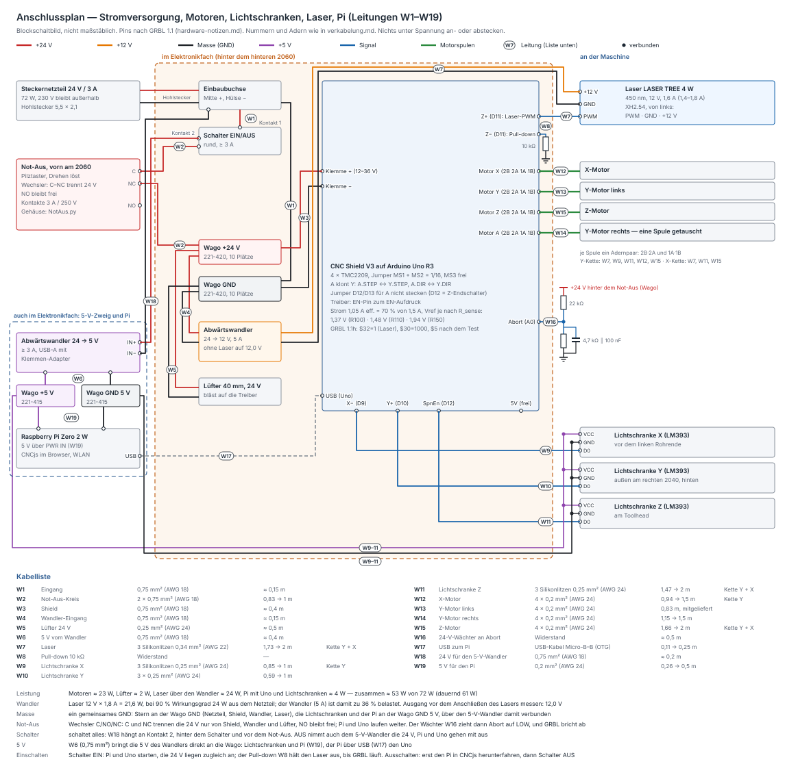
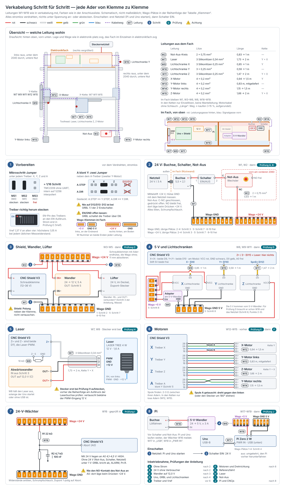
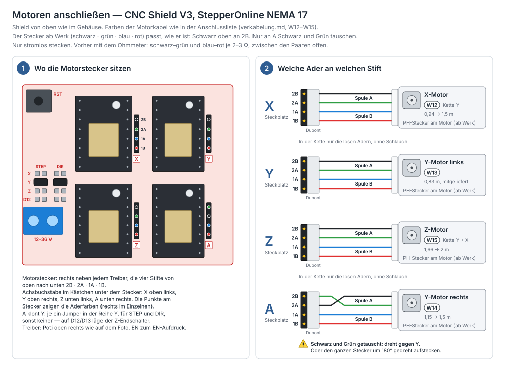

# Verkabelung — Strom, Motoren, Lichtschranken, Laser

Die ganze Verdrahtung, vom Steckernetzteil bis zum Laser, Schritt für
Schritt. Jede Leitung hat eine Nummer (W1 … W19). Sie steht an beiden Enden
auf dem Kabel, im [Anschlussplan](elektronik-anschluss.svg) und in den
Tabellen hier.

Die Kabelliste steht einmal in `tools/verkabelung.py`. Daraus entstehen die
Tabellen dieser Anleitung (`python3 tools/verkabelung.py`, schreibt nur
zwischen den Markierungen), der Anschlussplan
(`python3 tools/anschluss_zeichnen.py`) und das Bild zu
[Schritt für Schritt](#schritt-für-schritt)
(`python3 tools/verkabelung_zeichnen.py`). `python3 tools/elektronik_check.py`
prüft in Abschnitt 16 die Netze (kein Kurzschluss, der Not-Aus trennt die
24 V von Shield, Wandler und Lüfter, der Pi hängt davor, aber hinter dem
Schalter), Signale und Pins,
Kontakte, Klemmen und Längen und ob die Tabellen hier aktuell sind. Wo
Gehäuse, Kabelwege und Ketten liegen, steht
in [elektronik.md](elektronik.md). Pins, Treiber und Jumper im Einzelnen
stehen in [hardware-notizen.md](hardware-notizen.md#elektronik).

## Vorab: sechs Regeln

1. **Nichts unter Spannung an- oder abstecken**, vor allem keine Motoren.
   Ein Motorstecker, der unter Strom abgeht, kostet den Treiber.
2. **Die 24 V messen, bevor das Shield dran ist.** Verpolt sind die
   Treiber hin.
3. **Den Wandler ohne Laser auf 12,0 V stellen.**
4. **Der Schalter schaltet alles, auch den Pi: vor dem Ausschalten den Pi
   herunterfahren.** Der [Pi](pi.md) hängt hinter dem Schalter, aber vor
   dem Not-Aus. Beim Einschalten bekommen Pi, Uno und die 24 V zugleich
   Strom. Bis GRBL nach etwa einer Sekunde läuft, hält der Pull-down W8 den
   Laser aus ([Prüfung H](#h-laser)); auf den Pi musst du nicht warten.
   Ausschalten: in CNCjs **Pi herunterfahren**, etwa 20 Sekunden warten,
   dann den Schalter. Der Not-Aus trennt nur Motoren, Laser und Lüfter, Pi
   und Uno laufen weiter. Hängt statt des Pi der Mac am Uno: erst USB, dann
   24 V.
5. **Beim ersten Lasertest eine Schutzbrille für 450 nm tragen**, auch bei
   wenig Leistung.
6. **Jede Leitung an beiden Enden mit ihrer W-Nummer beschriften.**

## Übersicht

Drei Spannungen, eine gemeinsame Masse:

| Spannung | kommt von | versorgt | geschaltet |
|---|---|---|---|
| **+24 V** | Steckernetzteil 24 V / 3 A über Einbaubuchse, Schalter und Not-Aus | Shield (vier Treiber), Wandler, Lüfter | Schalter und Not-Aus |
| **+24 V vor dem Not-Aus** | Kontakt 2 des Schalters, W18 | nur den 5-V-Wandler des Pi | nur der Schalter, der Not-Aus nicht |
| **+12 V** | Wandler 24 → 12 V | nur den Laser | mit den 24 V |
| **+5 V** | 5-V-Wandler → Wago +5 V (W6): Lichtschranken und Pi (W19), der Pi über USB (W17) den Uno | Pi, Uno, die drei Lichtschranken | wie der 5-V-Wandler: nur der Schalter |
| **GND** | alles verbunden, Stern an der Wago GND | | |

Signale: Die Lichtschranken X, Y und Z melden an D9, D10 und D12. Der Laser
bekommt seine Leistung als PWM von D11. Ein Spannungsteiler an den 24 V
meldet an A0 (Abort), wenn sie fehlen.

Kein 230 V in der Maschine: Das Steckernetzteil liefert 24 V, am Rahmen
muss nichts geerdet werden. Eine Sicherung braucht es nicht, das Netzteil
begrenzt den Strom selbst.

## Leitungen

<!-- tabelle:leitungen -->
| Nr | Leitung | Litze | Weg | Länge | kaufen | Kette |
|---|---|---|---|---|---|---|
| W1 | **Eingang** | 0,75 mm² (AWG 18) | im Fach rechts: Buchse und Schalter in der Rückwand | ≈ 0,15 m je Ader | Rolle | — |
| W2 | **Not-Aus-Kreis** — beide Adern führen +24 V: an beiden Enden rot markieren; NO bleibt frei | 2 × 0,75 mm² (AWG 18) | rechts raus (Fenster Leistung), unter dem rechten 2040 durch, untere Nut außen am rechten 2040 nach vorn, obere Nut vorn am 2060 zum Gehäuse | 0,83 m | **1 m** | — |
| W3 | **Shield** | 0,75 mm² (AWG 18) | im Fach: Leistungsgasse, durch die Fuge zur Klemme des Shields | ≈ 0,4 m je Ader | Rolle | — |
| W4 | **Wandler-Eingang** | 0,75 mm² (AWG 18) | im Fach rechts | ≈ 0,15 m je Ader | Rolle | — |
| W5 | **Lüfter 24 V** — verlängert die Litze des Lüfters, dazwischen ein Dupont-Stecker 2-polig: der Deckel geht ab | 0,25 mm² (AWG 24) | im Fach: vom Deckel durch die Lüfteröffnung, Leistungsgasse, durch die Fuge zu den Wago | ≈ 0,5 m je Ader | Rolle | — |
| W6 | **5 V vom Wandler** — kurz und dick: Lichtschranken und Pi hängen direkt am Wandler, nicht mehr am Uno | 0,75 mm² (AWG 18) | im Fach: vom USB-A-Adapter am 5-V-Wandler durch die Signalgasse und die Fuge zu den 5-V-Klemmen links | ≈ 0,4 m je Ader | Rolle | — |
| W7 | **Laser** | 3 Silikonlitzen 0,34 mm² (AWG 22) | links raus (Fenster Leistung), unter dem linken 2040 durch, untere Nut außen am linken 2040, hinten in die Y-Kette, hinter dem Schlitten in die obere Nut des Rohrs, am Kabelflügel hoch in die X-Kette, Trägerplatte; im Fach +12 V und GND durch Leistungsgasse und Fuge zum Wandler, PWM links zum Shield | 1,73 m | **2 m** | Y + X |
| W8 | **Pull-down 10 kΩ** — hält den Laser aus, solange der Uno startet oder ohne USB ist | Widerstand | auf dem Shield | — | — | — |
| W9 | **Lichtschranke X** | 3 Silikonlitzen 0,25 mm² (AWG 24) | links raus (Fenster Signal), unter dem linken 2040 durch, untere Nut außen am linken 2040, Y-Kette, hinter dem Schlitten über das Rohr nach vorn zum Halter X | 0,85 m | **1 m** | Y |
| W10 | **Lichtschranke Y** | 3 × 0,25 mm² (AWG 24) | im Fach durch die Signalgasse nach rechts, rechts raus (Fenster Signal), unter dem rechten 2040 durch, untere Nut außen am rechten 2040 nach hinten | 0,59 m | **1 m** | — |
| W11 | **Lichtschranke Z** | 3 Silikonlitzen 0,25 mm² (AWG 24) | links raus (Fenster Signal), unter dem linken 2040 durch, untere Nut außen am linken 2040, Y-Kette, X-Kette bis zur Trägerplatte, dann zum Halter am Toolhead | 1,47 m | **2 m** | Y + X |
| W12 | **X-Motor** — in der Kette nur die losen Adern, ohne Schlauch | 4 × 0,2 mm² (AWG 24) | links raus (Fenster Leistung), unter dem linken 2040 durch, untere Nut außen am linken 2040, Y-Kette, hinter dem Motorhalter hoch zum Motor | 0,94 m | **1,5 m**, fertig | Y |
| W13 | **Y-Motor links** | 4 × 0,2 mm² (AWG 24) | links raus (Fenster Leistung), unter dem linken 2040 durch, untere Nut außen am linken 2040 nach vorn; in den Kabelhaltern unter den Wänden der drei Träger der Wanne Y durch | 0,83 m | mitgeliefert (1 m) | — |
| W14 | **Y-Motor rechts** — Spule A getauscht: dreht gegen den linken | 4 × 0,2 mm² (AWG 24) | im Fach durch die Leistungsgasse nach rechts, rechts raus (Fenster Leistung), unter dem rechten 2040 durch, untere Nut außen am rechten 2040 nach vorn | 1,15 m | **1,5 m**, fertig | — |
| W15 | **Z-Motor** — in den Ketten nur die losen Adern, ohne Schlauch | 4 × 0,2 mm² (AWG 24) | wie W7 bis zur Trägerplatte, dann zum Motor oben | 1,66 m | **2 m**, fertig | Y + X |
| W16 | **24-V-Wächter an Abort** — fehlen die 24 V hinter dem Not-Aus, bricht GRBL ab | Widerstand | im Fach: Teiler an den Wago 24 V und GND rechts, die Mitte als Einzelader 0,25 mm² durch die Signalgasse an Abort | ≈ 0,5 m je Ader | Rolle | — |
| W17 | **USB zum Pi** — kurzes Kabel; Micro-B in die Buchse „USB“ des Pi, nicht in „PWR IN“ | USB-Kabel Micro-B–B (OTG) | im Fach links: vom USB-B des Uno unter dem Pi in seine Buchse „USB“ | 0,11 m | **0,25 m**, fertig | — |
| W18 | **24 V für den 5-V-Wandler** — hinter dem Schalter, vor dem Not-Aus: Der Schalter schaltet Pi und Uno mit aus, der Not-Aus nicht | 0,75 mm² (AWG 18) | im Fach rechts: rot an Kontakt 2 des Schalters gelötet, schwarz an der Hülse der Buchse, zum Eingang des 5-V-Wandlers | ≈ 0,2 m je Ader | Rolle | — |
| W19 | **5 V für den Pi** — Stromadern mindestens AWG 24 | 0,2 mm² (AWG 24) | im Fach links: von den 5-V-Klemmen durch die Signalgasse zum Pi, von unten in „PWR IN“ | 0,26 m | **0,5 m**, fertig | — |
<!-- /tabelle:leitungen -->

„Länge“ ist der Weg wie in [elektronik-platz.svg](elektronik-platz.svg)
gezeichnet, „kaufen“ dieser Weg plus 15 % und aufgerundet. Was übrig ist,
bleibt als Schlaufe beim Gehäuse. Die Motorfarben sind die übliche Belegung
von Stepperonline `[w]`: A+ schwarz, A− grün, B+ rot, B− blau. Am Stecker ab
Werk liegen sie schwarz · grün · blau · rot `[v]` (außen schwarz und rot),
also A+ · A− · B− · B+. Vor dem Anschließen mit dem Ohmmeter prüfen
([Motoren](#6-motoren-w12w15)).

## Anschlussliste

<!-- tabelle:anschluesse -->
| Nr | Ader | Farbe | von | an |
|---|---|---|---|---|
| W1 | +24 V | rot | Einbaubuchse, Mittelstift (+) | Schalter, Kontakt 1 |
|  | GND | schwarz | Einbaubuchse, Hülse (−) | Wago GND |
| W2 | +24 V hin | Ader 1 | Schalter, Kontakt 2 | Not-Aus, C |
|  | +24 V zurück | Ader 2 | Not-Aus, NC | Wago +24 V |
| W3 | +24 V | rot | Wago +24 V | Shield, Schraubklemme + |
|  | GND | schwarz | Wago GND | Shield, Schraubklemme − |
| W4 | +24 V | rot | Wago +24 V | Wandler IN+ |
|  | GND | schwarz | Wago GND | Wandler IN− |
| W5 | +24 V | rot | Lüfter, Stecker: rot | Wago +24 V |
|  | GND | schwarz | Lüfter, Stecker: schwarz | Wago GND |
| W6 | +5 V | rot | USB-A-Adapter am 5-V-Wandler, Klemme 5V | Wago +5 V |
|  | GND | schwarz | USB-A-Adapter am 5-V-Wandler, Klemme GND | Wago GND 5 V |
| W7 | +12 V | rot | Wandler OUT+ | Laser, XH rechts: +12 V |
|  | GND | schwarz | Wandler OUT− | Laser, XH Mitte: GND |
|  | PWM | weiß | Shield Z+ (D11), Signalstift | Laser, XH links: PWM |
| W8 | 10 kΩ | — | Shield Z− (D11), Signalstift | Shield Z−, GND-Stift |
| W9 | +5 V | rot | Wago +5 V | Lichtschranke X, VCC |
|  | GND | schwarz | Wago GND 5 V | Lichtschranke X, GND |
|  | Signal | gelb | Shield X− (D9), Signalstift | Lichtschranke X, D0 |
| W10 | +5 V | rot | Wago +5 V | Lichtschranke Y, VCC |
|  | GND | schwarz | Wago GND 5 V | Lichtschranke Y, GND |
|  | Signal | gelb | Shield Y+ (D10), Signalstift | Lichtschranke Y, D0 |
| W11 | +5 V | rot | Wago +5 V | Lichtschranke Z, VCC |
|  | GND | schwarz | Wago GND 5 V | Lichtschranke Z, GND |
|  | Signal | gelb | Shield SpnEn (D12) | Lichtschranke Z, D0 |
| W12 | Spule A | schwarz · grün | Shield Motor X, 2B · 2A | X-Motor, Spule A: A+ · A− |
|  | Spule B | blau · rot | Shield Motor X, 1A · 1B | X-Motor, Spule B: B− · B+ |
| W13 | Spule A | schwarz · grün | Shield Motor Y, 2B · 2A | Y-Motor links, Spule A: A+ · A− |
|  | Spule B | blau · rot | Shield Motor Y, 1A · 1B | Y-Motor links, Spule B: B− · B+ |
| W14 | Spule A, getauscht | grün · schwarz | Shield Motor A, 2B · 2A | Y-Motor rechts, Spule A: A− · A+ |
|  | Spule B | blau · rot | Shield Motor A, 1A · 1B | Y-Motor rechts, Spule B: B− · B+ |
| W15 | Spule A | schwarz · grün | Shield Motor Z, 2B · 2A | Z-Motor, Spule A: A+ · A− |
|  | Spule B | blau · rot | Shield Motor Z, 1A · 1B | Z-Motor, Spule B: B− · B+ |
| W16 | R1 22 kΩ | — | Wago +24 V | Shield Abort (A0) |
|  | R2 4,7 kΩ ∥ 100 nF | — | Shield Abort (A0) | Wago GND |
| W17 | USB | — | Uno, USB-B | Pi, Micro-USB „USB“ |
| W18 | +24 V | rot | Schalter, Kontakt 2 | 5-V-Wandler IN+ |
|  | GND | schwarz | Einbaubuchse, Hülse (−) | 5-V-Wandler IN− |
| W19 | +5 V | rot | Wago +5 V | Pi, „PWR IN“: +5 V |
|  | GND | schwarz | Wago GND 5 V | Pi, „PWR IN“: GND |
<!-- /tabelle:anschluesse -->

## Klemmen: Wago und Shield

<!-- tabelle:wago -->
| Klemme | Typ | belegt | frei | angeschlossen |
|---|---|---|---|---|
| **Wago +24 V** | 221-420 | 5 von 10 | 5 (einer davon für Air Assist) | W2 Not-Aus, NC · W3 Shield, Schraubklemme + · W4 Wandler IN+ · W5 Lüfter, Stecker: rot · W16 Shield Abort (A0) |
| **Wago GND** | 221-420 | 5 von 10 | 5 (2 davon für Air Assist und OUT− eines isolierten Wandlers) | W1 Einbaubuchse, Hülse (−) · W3 Shield, Schraubklemme − · W4 Wandler IN− · W5 Lüfter, Stecker: schwarz · W16 Shield Abort (A0) |
| **Wago +5 V** | 221-415 | 5 von 5 | 0 | W6 USB-A-Adapter am 5-V-Wandler, Klemme 5V · W9 Lichtschranke X, VCC · W10 Lichtschranke Y, VCC · W11 Lichtschranke Z, VCC · W19 Pi, „PWR IN“: +5 V |
| **Wago GND 5 V** | 221-415 | 5 von 5 | 0 | W6 USB-A-Adapter am 5-V-Wandler, Klemme GND · W9 Lichtschranke X, GND · W10 Lichtschranke Y, GND · W11 Lichtschranke Z, GND · W19 Pi, „PWR IN“: GND |
<!-- /tabelle:wago -->

<!-- tabelle:shield -->
| Stift | Uno-Pin | Aufgabe | angeschlossen |
|---|---|---|---|
| Schraubklemme + | — | 24 V für die Treiber (12–36 V) | W3 → Wago +24 V |
| Schraubklemme − | — | GND | W3 → Wago GND |
| Stift 5V | 5 V | frei — die Lichtschranken bekommen 5 V vom Wandler (W6) | — |
| X− (D9), Signalstift | D9 | Endschalter X (X+ ist derselbe Pin) | W9 → Lichtschranke X, D0 |
| Y+ (D10), Signalstift | D10 | Endschalter Y (Y− ist derselbe Pin) | W10 → Lichtschranke Y, D0 |
| SpnEn (D12) | D12 | Endschalter Z — GRBL 1.1 legt ihn auf D12 | W11 → Lichtschranke Z, D0 |
| Z+ (D11), Signalstift | D11 | Laser-PWM — kein Endschalter | W7 → Laser, XH links: PWM |
| Z− (D11), Signalstift | D11 | Pull-down 10 kΩ zum GND-Stift daneben | W8 → Shield Z−, GND-Stift |
| Abort (A0) | A0 | 24-V-Wächter: ohne 24 V bricht GRBL ab | W16 → Wago +24 V · W16 → Wago GND |
| Motor X, Y, Z, A | — | 2B · 2A · 1A · 1B je Treiber; A klont Y (Jumper) | W12 · W13 · W15 · W14 |
<!-- /tabelle:shield -->

* Auf dem Shield liegen **X+ und X− auf demselben Pin** (D9), ebenso Y+/Y−
  (D10) und Z+/Z− (D11). Stecken nur dort, wo die Tabelle es sagt: An
  Z+/Z− liegt die Laser-PWM, das ist ein Ausgang.
* Die Masse der Lichtschranken geht an die Wago GND, nicht an einen
  GND-Stift am Shield. So muss niemand GND-Stifte suchen, und neben SpnEn
  gibt es womöglich keinen.
* **Jumper:** MS1 + MS2 an allen vier Treibern (1/16), MS3 frei. A klont
  Y: A.STEP ↔ Y.STEP und A.DIR ↔ Y.DIR. Die Jumper **D12/D13 für A nicht
  stecken**, denn D12 ist der Z-Endschalter. EN/GND bleibt offen, GRBL
  schaltet die Treiber über D8.
* **Treiber** mit dem EN-Pin zum EN-Aufdruck stecken.

## Material und Werkzeug

<!-- tabelle:material -->
| Menge | Teil | für |
|---|---|---|
| 1,5 m | Einzelader 0,75 mm² (AWG 18), rot | W1 0,15 m · W3 0,4 m · W4 0,15 m · W6 0,4 m · W18 0,2 m |
| 1,5 m | Einzelader 0,75 mm² (AWG 18), schwarz | W1 0,15 m · W3 0,4 m · W4 0,15 m · W6 0,4 m · W18 0,2 m |
| 1 m | 2 × 0,75 mm² (AWG 18) | W2 1 m |
| 1,5 m | 3 × 0,25 mm² (AWG 24) | W5 0,5 m · W10 1 m |
| 2 m | Silikonlitze 0,34 mm² (AWG 22), rot | W7 2 m |
| 2 m | Silikonlitze 0,34 mm² (AWG 22), schwarz | W7 2 m |
| 2 m | Silikonlitze 0,34 mm² (AWG 22), weiß | W7 2 m |
| 3 m | Silikonlitze 0,25 mm² (AWG 24), rot | W9 1 m · W11 2 m |
| 3 m | Silikonlitze 0,25 mm² (AWG 24), schwarz | W9 1 m · W11 2 m |
| 3 m | Silikonlitze 0,25 mm² (AWG 24), gelb | W9 1 m · W11 2 m |
| 1 + 1 | Motorkabel 1,5 m und 2 m, 4 × AWG 24, PH-Stecker zum Motor, Dupont 4-polig zum Shield; für W15 lose Adern ohne Mantel (läuft durch beide Ketten) | W14, W15 (W12, W13: die mitgelieferten 1-m-Kabel) |
| 1 | USB-Kabel Micro-B–B (OTG), 0,25 m | W17 (USB zum Pi) |
| 1 | Micro-USB-Kabel mit offenen Enden, 0,5 m | W19 (5 V für den Pi) |
| 16 + Reserve | Dupont-Crimpkontakte (Buchse) | Shield, Lichtschranken, W8, W16 |
| 5 · 1 · 3 | Dupont-Gehäuse 1-, 2- und 3-polig | Shield, Pull-down, Lichtschranken |
| 1 + 3 | XH2.54-Gehäuse 3-polig + Crimpkontakte | Laser |
| 2 | Aderendhülse 0,34 mm² | Schraubklemmen |
| 8 | Aderendhülse 0,75 mm² | Schraubklemmen |
| 1 | Widerstand 10 kΩ, ¼ W | W8 |
| 1 + 1 + 1 | Widerstand 22 kΩ und 4,7 kΩ, ¼ W; Kondensator 100 nF | W16 |
| — | Not-Aus-Pilztaster 16 mm, Wechsler C/NO/NC, 3 A / 250 V (vorhanden), Gehäuse aus [NotAus.py](notaus.md) | W2 |
| — | Schrumpfschlauch 2–6 mm, Kabelbinder, Beschriftung (W-Nummer an beiden Enden) | alle |
<!-- /tabelle:material -->

* **Litze:** in den Ketten nur Einzellitzen aus Silikon, keine
  Mantelleitungen: Die gedruckten Ketten biegen mit R 20
  ([energiekette.md](energiekette.md#litzen-in-der-kette)). Für die
  Signale 0,25 mm²: Das hält sicher in der
  Wago (ab 0,14 mm²), und in den Dupont-Kontakt passen bis 0,34 mm². Ist
  schon Litze mit 0,14 mm² oder AWG 26 (0,13 mm²) da, geht sie auch: in
  der Wago das abisolierte Ende doppelt legen.
* **Werkzeug:** Crimpzange für Dupont und XH (2,54 mm, z. B. SN-28B),
  Zange für Aderendhülsen, Abisolierzange, Lötkolben, Multimeter mit
  Durchgangsprüfer, Schrumpfschlauch.
* **Wago 221:** 11 mm abisolieren, Hebel auf, Litze bis zum Anschlag, Hebel
  zu. Ohne Aderendhülse.
* **Schraubklemmen** (Shield, Wandler): immer mit Aderendhülse.
  Verzinnte Litze gibt in der Klemme mit der Zeit nach.
* **Dupont und XH:** 2 mm abisolieren, crimpen, an jedem Kontakt ziehen.
  Die Kontakte rasten im Gehäuse hörbar ein.

## Schritt für Schritt

Zuerst alles im Gehäuse, dann nach außen zur Maschine. Die Prüfungen der
[Inbetriebnahme](#inbetriebnahme) gehören jeweils dazwischen.

Das Bild zeigt jeden der acht Schritte für sich: jede Ader von Klemme zu
Klemme in ihrer Farbe aus der [Anschlussliste](#anschlussliste), die
Wago-Plätze in der Reihenfolge der Tabelle
[Klemmen](#klemmen-wago-und-shield), und welche Prüfung danach kommt. Oben
die Leitungen, die das Gehäuse verlassen, mit ihren Wegen. Das Bild entsteht
aus derselben Kabelliste und bricht ab, wenn eine Ader fehlt, doppelt oder
im falschen Schritt gezeichnet ist.

### 1. Vorbereiten

* Die Leitungen nach der Tabelle ablängen und an beiden Enden mit der
  W-Nummer beschriften.
* Einbaubuchse und Schalter hinten ins Gehäuse setzen (Mutter innen,
  Schalter rastet ein), die Wago-Klemmen mit Klebeband auf ihren Platz:
  von links **+5 V**, **GND**, **+24 V**.

### 2. 24 V: Buchse, Schalter, Not-Aus (W1, W2)

1. **Einbaubuchse:** Mit dem Durchgangsprüfer die Lötfahne des
   Mittelstifts suchen. Dann das Netzteil einstecken und messen: Am
   Mittelstift liegen **+24 V** gegen die Hülse (bei diesen Netzteilen
   üblich `[w]`, trotzdem messen). Hat die Buchse eine dritte Fahne
   (Schaltkontakt), bleibt sie frei.
2. **W1:** rot von der Mittelfahne an Kontakt 1 des Schalters, schwarz von
   der Hülse an die **Wago GND**. Anlöten, Schrumpfschlauch darüber.
   **W18** für den Pi gleich mit anlöten: schwarz an die Hülse der Buchse,
   rot aber an **Kontakt 2** des Schalters, nicht an die Mittelfahne. So
   schaltet der Schalter den Pi mit aus
   ([Schritt 8](#8-pi-w17w19)). Das freie Ende von W18 isolieren, bis es am
   5-V-Wandler sitzt: Es führt 24 V, sobald der Schalter an ist.
3. **W2** zum Not-Aus nach vorn. Er hat einen **Wechsler** mit drei
   Lötfahnen, C, NO und NC `[v]` (Bild). Ader 1 kommt von Kontakt 2 des
   Schalters an **C**, Ader 2 geht von **NC** zurück an die **Wago
   +24 V**. An Kontakt 2 sitzen damit zwei Adern, Ader 1 von W2 und das Rot
   von W18: beide durch die Öse stecken, dann löten. Beide Adern von W2
   führen +24 V, deshalb an beiden Enden rot
   markieren. **NO bleibt frei:** Beim Drücken liegt dort C, also +24 V.
   Anlöten, Schrumpfschlauch über jede Fahne. Der Not-Aus sitzt in seinem
   Gehäuse vorn am vorderen 2060 ([notaus.md](notaus.md)); W2 kommt von
   rechts in der oberen Nut des 2060.

Dann [Prüfung A und B](#a-ohne-strom).

### 3. Shield, Wandler, Lüfter (W3–W5)

1. **W3:** Wago +24 V → Schraubklemme **+** des Shields, Wago GND →
   Schraubklemme **−**. Die Polung steht neben der Klemme. **Nicht
   vertauschen.**
2. **W4:** Wago +24 V → **IN+** des Wandlers, Wago GND → **IN−**.
3. **W5:** Die Litzen des Lüfters in die Wagos, rot an +24 V, schwarz an
   GND. Ist die Litze dünner als 0,14 mm², das abisolierte Ende doppelt
   legen. Der Lüfter bläst nach unten auf die Treiber (Pfeil am Rahmen).
4. **Masse des Wandlers:** Durchgang zwischen IN− und OUT− prüfen. Die
   üblichen Wandler haben eine gemeinsame Masse. Ohne Durchgang eine Brücke
   von OUT− an die Wago GND legen, der Platz dort ist frei gehalten.

Dann [Prüfung C](#c-wandler-auf-120-v).

### 4. 5 V und Lichtschranken (W6, W9–W11)

1. **W6:** vom Stift **5V** des Shields (Dupont 1-polig) an die **Wago
   +5 V**.
2. An jeder Lichtschranke ein 3-poliges Dupont-Gehäuse, die Adern nach dem
   Aufdruck am Modul: **VCC** rot, **GND** schwarz, **D0** gelb. Hat das
   Modul noch einen Stift A0, bleibt er frei.
3. Im Gehäuse: rot an die **Wago +5 V**, schwarz an die **Wago GND**, gelb
   mit einem 1-poligen Dupont-Gehäuse auf den Eingang: X → **X−** (D9),
   Y → **Y+** (D10), Z → **SpnEn** (D12).
4. Wege: X durch die Y-Kette, hinter dem Schlitten über das Rohr nach
   vorn zum Halter ([endschalter.md](endschalter.md)); Y durch den Kanal
   und in der unteren Nut außen am rechten 2040 nach hinten; Z durch beide
   Ketten zum Toolhead. Hat die Z-Lichtschranke schon ein Kabel: Es muss
   bis zum Gehäuse reichen, also 2 m lang sein.

Dann [Prüfung D](#d-uno-grbl-und-lichtschranken).

### 5. Laser (W7, W8)

1. **W7** an den Laser: XH-Stecker 3-polig, von links **PWM · GND ·
   +12 V** `[v]` Angabe. **Vor dem ersten Einschalten mit dem Aufdruck an
   der Buchse des Lasers vergleichen**: Vertauscht bekäme der PWM-Eingang
   12 V.
2. Im Gehäuse: rot an **OUT+** des Wandlers, schwarz an **OUT−**, weiß mit
   einem 1-poligen Dupont-Gehäuse auf den Signalstift von **Z+** (D11).
3. **W8:** einen Widerstand 10 kΩ in ein 2-poliges Dupont-Gehäuse crimpen
   und auf **Z−** stecken, Signal- und GND-Stift. Z− und Z+ liegen beide
   auf D11: Der Widerstand zieht die PWM auf 0 V, solange der Uno startet
   oder ohne USB ist. Ohne ihn kann der Laser in dieser Zeit aufblitzen.
4. Den Stecker am Laser erst bei [Prüfung H](#h-laser) aufstecken.

### 6. Motoren (W12–W15)

Der Motorstecker sitzt rechts neben jedem Treiber, die Stifte von oben
2B · 2A · 1A · 1B, der Achsbuchstabe im Kästchen darunter: X oben links,
Y oben rechts, Z unten links, A unten rechts `[v]` (am Shield abgelesen,
Reset-Taster oben links). Das Bild erzeugt
`python3 tools/motoren_zeichnen.py`.

1. **Spulen finden:** Zwischen den zwei Adern einer Spule zeigt das
   Ohmmeter wenige Ohm (etwa 2–3 Ω), zwischen Adern verschiedener Spulen
   nichts.
2. **Am Shield** gehört jede Spule auf ein Stiftpaar: **2B · 2A** und
   **1A · 1B**, wie neben jedem Treiber aufgedruckt. Welche Spule auf
   welchem Paar liegt und wie herum, bestimmt nur die Drehrichtung.
   Der Stecker ab Werk (schwarz · grün · blau · rot) passt so, wie er ist:
   **Schwarz oben an 2B**, dann grün an 2A, blau an 1A, rot an 1B.
3. X-Motor → **X**, Y-Motor links → **Y**, Z-Motor → **Z**, Y-Motor rechts →
   **A**.
4. **Y-Motor rechts mit getauschter Spule:** Beide Y-Motoren bekommen
   dasselbe Signal, müssen aber gegenläufig drehen. Deshalb am Stecker des
   rechten zwei Adern **einer** Spule tauschen, schwarz und grün. Die
   Kontakte lassen sich mit einer Nadel aus dem Dupont-Gehäuse lösen. Den
   4-poligen Stecker um 180° gedreht aufzustecken, wirkt genauso
   ([Zwei Y-Motoren](hardware-notizen.md#zwei-y-motoren)).
5. **In den Ketten nur die losen Adern:** Beim X-Motor (W12) und beim
   Z-Motor (W15) den Schlauch oder Mantel so weit entfernen, wie das Kabel
   durch die Ketten läuft, und die vier Adern einzeln einziehen.
6. Alles nur bei ausgeschaltetem Strom.

### 7. 24-V-Wächter (W16)

Der Not-Aus trennt die 24 V. Motoren und Laser sind dann stromlos, der Uno
läuft aber weiter, über USB vom Pi versorgt, und GRBL arbeitet den Auftrag
weiter ab. Wird der Not-Aus wieder entriegelt, bekommen Motoren und Laser
mitten im Auftrag wieder Strom, und der Laser brennt mit der Leistung, die
gerade gilt.

Dagegen hilft der **24-V-Wächter**, ein Spannungsteiler an **Abort** (A0):

* **R1 22 kΩ** von der **Wago +24 V** an Abort,
* **R2 4,7 kΩ** und parallel dazu **100 nF** von Abort an die **Wago GND**.

Mit 24 V liegen an A0 4,1 bis 4,5 V, also HIGH. Fehlen die 24 V, zieht R2
den Eingang auf unter 1 V. GRBL bricht dann sofort ab, schaltet den Laser
aus und meldet ALARM; im Status steht `Pn:R`, solange die 24 V fehlen. Das
gilt für den Not-Aus. Mit dem Schalter oder dem Netzteil gehen Pi und Uno
mit aus; nur wenn der Uno statt am Pi am Mac hängt, meldet der Wächter auch
den Schalter.
Der Kondensator filtert Störungen aus der 24-V-Leitung.

Bauen: An jedes Ende eine kurze Litze 0,25 mm² anlöten, die Verbindung
beider Widerstände mit dem Kondensator in Schrumpfschlauch, von dort ein
1-poliger Dupont-Stecker auf **Abort**. Die Litzen enden in den Wagos. Auch
wenn der Stecker verrutscht, fließt über 22 kΩ höchstens 1 mA; das hält
jeder Pin aus.

Warum nicht der zweite Kontakt des Not-Aus: Er ist ein Wechsler, an NO läge
beim Drücken C, also +24 V. Das zerstört den Uno. Der Wächter braucht keinen
Kontakt und meldet mehr als nur den Not-Aus.

### 8. Pi (W17–W19)

Der Pi steuert die Maschine ohne PC: Aufträge aus LightBurn liegen als
Datei auf ihm und starten im Browser ([pi.md](pi.md)). Er sitzt mit seinem
5-V-Wandler auf dem [Pi-Halter](pi.md#halter) rechts neben dem Kasten, unter
einer [Haube](pi.md#haube).

1. **Pi-Halter** bestücken, solange er lose ist: die drei Messing-Einsätze
   für die Haube einschmelzen. Den Pi mit 4 × M2.5×6 auf die Stehbolzen,
   Bauteile nach hinten, Buchsen nach unten. Den 5-V-Wandler links daneben,
   Eingang zum Kasten, USB-Buchse zum Pi, mit 2 Kabelbindern 2,5 × 200 durch
   die Schlitze über und unter ihm ([pi.md, Montage](pi.md#halter)). Dann
   an die Rückseite des hinteren 2060, rechts neben die Montageplatte des
   Kastens: 2 Hammermuttern in die obere Nut, 2 × M5×12.
2. **W18** hängt schon an Schalter und Buchse (Schritt 2): rot an Kontakt 2
   des Schalters, also hinter dem Schalter und vor dem Not-Aus, schwarz an
   der Hülse der Buchse. Vorn aus dem Kasten, im Kanal nach rechts, an der
   Rückseite des 2060 unter dem Pi-Halter durch, von unten in die Haube und
   links neben dem Wandler hoch: rot an **IN+**, schwarz an **IN−** des
   5-V-Wandlers, mit Aderendhülsen.
3. Not-Aus drücken, Netzteil einstecken, Schalter an: Am USB-Ausgang des
   Wandlers liegen **5,0–5,2 V**. Schalter wieder aus. Erst dann weiter.
4. **W19:** das kurze USB-Kabel vom Wandler in **PWR IN** des Pi. Ein
   längeres vorher auf etwa 15 cm kürzen ([pi.md](pi.md#w19-kürzen)).
5. **W17:** das OTG-Kabel von der Buchse **USB** des Pi (die mittlere, nicht
   PWR IN) nach unten aus der Haube, nach links, rechts am Kasten vorbei
   nach hinten und hinter ihm ins USB-Fenster des Uno.
6. **Haube** aufsetzen, 3 × M3×8 in die Einsätze.

Für GRBL aufspielen und die ersten Prüfungen darf statt des Pi der Mac am
USB des Uno hängen. Dann [Prüfung J](#j-pi-und-cncjs).

## Kabelwege und Ketten

Die Wege zeigt [elektronik-platz.svg](elektronik-platz.svg), beschrieben
sind sie in [elektronik.md](elektronik.md#kabel).

* **Links aus dem Gehäuse** unter dem linken 2040 durch in dessen untere
  Außennut: W13 nach vorn zum linken Y-Motor, an den drei Trägern der
  Wanne Y in den Kabelhaltern unter ihrer Wand durch; W7, W9, W11, W12 und W15
  bis hinter die Wanne Y, dort aus der Nut und von hinten in das Endstück
  180 der Y-Kette (zwei Kabelbinder durch die Schlitze im Wannenboden).
* **Vorn aus dem Gehäuse** in den Kanal, darin nach rechts, an der
  Rückseite des hinteren 2060 (mittlere Nut) zum rechten 2040 und in dessen
  untere Außennut: W14 und W2 nach vorn, W10 nach hinten zum Halter Y. W2
  verlässt die Nut vor dem 2060, läuft in dessen oberer Nut vorn nach
  links und rechts oben ins Gehäuse des Not-Aus. W18 geht mit bis unter
  den Pi-Halter, von unten in seine Haube und an ihrer linken Wand hoch zum
  5-V-Wandler.
* **Hinten aus dem Gehäuse** nur W17: aus dem USB-Fenster hinter dem
  Kasten nach rechts, an seiner rechten Wand nach vorn zum Pi. Der Pi-Halter
  sitzt über den Kabeln der mittleren Nut, die laufen unter ihm durch.
* **Y-Kette:** W7, W9, W11, W12, W15. Sie kommen hinten aus dem
  Anfangsstück auf dem Kettenhalter Y (ein Kabelbinder). W12 läuft hinter
  dem Motorhalter hoch zum X-Motor, W9 über das Rohr nach vorn zum Halter X.
  W7, W11 und W15 laufen auf der Schlittenplatte hinter Rückwand und
  Motorhalter nach innen, rechts daneben in die obere Nut des Rohrs, darin
  bis an den Kabelflügel der Wannenstütze am Festpunkt, vor ihm hoch (zwei
  Kabelbinder) und oben über den Riemen nach vorn in das Endstück 180 der
  X-Kette ([energiekette.md](energiekette.md#kabelweg-am-festpunkt)).
* **X-Kette:** W7, W11, W15 bis zum Kettenhalter hinten an der
  Trägerplatte ([energiekette.md](energiekette.md)).

In den Ketten: Die Adern liegen lose nebeneinander, nicht verdrillt, auch
die der Motorkabel, ohne Schlauch. Am Kettenhalter des Toolheads hält sie
ein Kabelbinder durch die zwei Schlitze neben dem Anfangsstück. Keine Löt-
oder Steckstelle in der Kette.
An den 2040 liegen die Kabel in neun [Kabelhaltern](kabelhalter.md) unter
der unteren Außennut, in der oberen Nut des Rohrs halten Nutabdeckungen
oder Clips sie.

## Inbetriebnahme

In dieser Reihenfolge. Jede Stufe prüft, was die nächste braucht. Bis I
hängt der Uno am Mac (USB, Konsole in LightBurn oder der Arduino-IDE),
„USB an“ heißt: Kabel vom Mac stecken. Der Pi läuft dabei mit, sobald der
Schalter an ist, und stört nicht. J bindet ihn ein.

Steckt W17 schon im Uno, geht alles auch ohne Mac: GRBL (D1) spielst du
vom Pi aus auf ([pi.md](pi.md#grbl-aufspielen)). „USB an“ heißt dann:
Not-Aus drücken und Schalter an. Pi und Uno laufen, die 24 V hinter dem
Not-Aus fehlen noch. „Schalter an“ und „24 V“ heißen: Not-Aus entriegeln.
Die Konsole ist die von CNCjs (verbinden wie in J3), und „alles aus“ heißt
Pi herunterfahren, dann Schalter aus.

### A. Ohne Strom

* Jede Ader gegen die [Anschlussliste](#anschlussliste) prüfen und an jedem
  Kontakt ziehen.
* Ohmmeter zwischen Wago +24 V und Wago GND: **kein Kurzschluss**. Der Wert
  steigt langsam, weil die Kondensatoren laden, das ist in Ordnung.
  Dasselbe zwischen Wago +5 V und GND.
* Jede Motorspule zeigt 2–3 Ω, zwischen den Spulen ist offen.

### B. 24 V ohne Verbraucher

* W3 und W4 noch nicht in den Wagos, der Lüfter darf dran sein.
* Netzteil einstecken, Schalter an: An der Wago +24 V liegen **+24 V gegen
  GND**, nicht −24 V.
* Not-Aus drücken: 0 V. Entriegeln: 24 V. Schalter aus: 0 V.

### C. Wandler auf 12,0 V

* W4 in die Wagos, Schalter an, am Ausgang des Wandlers messen und am Poti
  auf **12,0 V** stellen. Das Poti hat viele Umdrehungen; ab Werk steht oft
  eine andere Spannung.

### D. Uno, GRBL und Lichtschranken

1. GRBL 1.1h auf den Uno spielen (Arduino-IDE, Bibliothek `grbl`, Beispiel
   `grblUpload`), nur über USB. Hängt der Uno schon am Pi, geht es von
   dort ([pi.md](pi.md#grbl-aufspielen)).
2. Shield aufstecken, noch ohne Treiber, nur USB. Gegen GND messen: An den
   Signalstiften von X−, Y+ und an SpnEn liegen **etwa 5 V** (die Pull-ups
   von GRBL), an Z+ und Z− **0 V**, am Stift 5V **5 V**. Liegt an SpnEn
   nichts,
   ist GRBL ohne variable Spindel gebaut und der Z-Endschalter läge auf
   D11. Stimmt etwas davon nicht, hat das Shield eine andere Belegung:
   dann hier aufhören und nachsehen.
3. W6 und W9–W11 anschließen, weiter nur USB.
4. In der Konsole `?` senden. Ohne Fahne in der Gabel erscheint kein `Pn:`,
   mit Fahne `Pn:X` (bzw. Y, Z). Ist es umgekehrt, `$5` umstellen. Diese
   Module melden „unterbrochen“ meist mit HIGH `[w]`, also `$5=1`. Dann
   meldet auch eine gebrochene Signalader „ausgelöst“, die sichere
   Richtung. Ist der 24-V-Wächter (W16) schon angeschlossen und fehlen die
   24 V (am Mac: Schalter aus; am Pi: Not-Aus gedrückt), steht im `Pn:`
   zusätzlich ein `R`; das gehört dazu.

### E. Treiber und Vref

1. Alles aus. Die Treiber stecken, EN zum EN-Aufdruck, dazu die Jumper wie
   [oben](#klemmen-wago-und-shield). **Motoren noch nicht anschließen.**
   Hängen sie schon, dürfen sie bleiben: Solange nichts fährt, schaltet
   GRBL die Treiber ab (`$1=25`), dann fließt kein Motorstrom. Gefahren
   wird erst in F.
2. W3 in die Wagos. Ist die Haube schon drauf, kommt sie ab (4 × M3×8), der
   Lüfter bleibt angeschlossen. USB an, dann Schalter an.
3. Die schwarze Messleitung mit einer Krokodilklemme an GND, etwa an ein
   Stück Litze in einem freien Platz der Wago GND. Die rote auf die
   Metallschraube des Potis, sie ist der Schleifer.
4. Vref auf **1,37 V** stellen (1,35–1,40 V reicht), an allen vier gleich.
   Das gibt bei jedem üblichen Messwiderstand höchstens 1,05 A
   ([Vref](hardware-notizen.md#treiber-und-versorgung)). In kleinen
   Schritten drehen und nach jedem messen: In welche Richtung die Spannung
   steigt, zeigt erst das Messgerät. Nicht mit Kraft gegen den Anschlag.
   Am besten mit einem Schraubendreher aus Kunststoff oder Keramik: Rutscht
   einer aus Metall ab, kann er 24 V auf die Logik bringen, das kostet
   Treiber und Uno.
5. Alles aus, die Litze aus der Wago, Haube wieder drauf.

### F. Motoren und Drehrichtung

1. Bei ausgeschaltetem Strom W12–W15 anstecken, falls sie nicht schon
   stecken.
2. USB an, dann 24 V. Von Hand lassen sich die Motoren noch drehen: GRBL
   schaltet die Treiber erst zum Fahren ein und 25 ms nach dem Halt wieder
   ab (`$1=25`).
3. Jede Achse ein paar Millimeter langsam fahren, z. B. `$J=G91 X5 F500`
   (steht GRBL in ALARM, erst `$X`). Nach `$X` gelten die Softlimits ab der
   aktuellen Stellung, nicht ab den Schaltern: nur wenige Millimeter fahren.
   **X+ fährt nach rechts, Y+ nach hinten, Z+ nach oben.** Sonst das Bit
   der Achse in `$3` setzen (X = 1, Y = 2, Z = 4, zusammenzählen).
4. **Y:** Beide Seiten müssen das Portal in dieselbe Richtung ziehen.
   Hängen die Riemen noch nicht, von oben auf die Wellen schauen: Sie
   drehen gegenläufig. Wenn nicht, an A eine Spule tauschen, bei
   ausgeschaltetem Strom.

### G. Referenzfahrt

* **Vorher von Hand:** Jede Lichtschranke meldet richtig (D4), und ihr
  Schaltpunkt stimmt: X und Y wie in
  [endschalter.md](endschalter.md#schaltpunkt-einstellen), Z wie in
  [toolhead-z.md](toolhead-z.md#einstellen). Dazu jede Achse langsam von
  Hand an ihre Schranke schieben, Z an der Kupplung drehen (im Stillstand
  sind die Motoren stromlos), und auf die LED oder `?` achten. Die
  Richtungen aus F müssen stimmen, sonst fährt `$H` vom Schalter weg.
* GRBL-Werte wie [unten](#grbl-einstellungen), die Hand am Not-Aus. Beim
  ersten Mal die Achsen ein paar Zentimeter vor ihre Schranken stellen und
  langsamer suchen lassen: `$25=200`, danach wieder `$25=500`.
* `$H`: Z fährt nach oben bis zu seiner Lichtschranke, dann X nach links
  und Y nach hinten, beide zugleich. Jede Achse muss an ihrer eigenen
  Lichtschranke anhalten und darf nirgends anschlagen. Danach meldet `?`
  `Idle` ohne `Pn:`: Jede Achse steht 1 mm vor ihrem Schaltpunkt.
* Ab jetzt nach jedem Einschalten, nach dem Not-Aus und nach einem
  Hardlimit zuerst `$H`; `$X` nur nach ALARM:2. Vorn auf der Motorseite hat
  Y keinen Schalter, dort schützen allein die Softlimits, und die stimmen
  nur nach der Referenzfahrt
  ([endschalter.md](endschalter.md#softlimits-statt-zweitem-y-schalter)).
  In LightBurn „Auto-home on startup“ einschalten; in CNCjs nach dem
  Verbinden „Homing“ drücken, nicht „Unlock“.

### H. Laser

1. Alles aus. Den XH-Stecker aufstecken, die Reihenfolge am Aufdruck
   prüfen.
2. `$32=1` (Lasermodus) und `$30=1000`.
3. **Schutzbrille auf**, Karton unter den Laser, Fokus grob einstellen.
4. Mit 1 % Leistung eine kurze Linie: `G91`, `M3 S10`, `G1 X10 F600`, `M5`,
   `G90`. In LightBurn geht dasselbe mit „Fire“ bei 1 %.
5. Nach `M5` und im Stillstand ist der Laser aus.
6. **Ohne USB** (weder Mac noch Pi am Uno) die 24 V einschalten: Der
   Laser muss aus bleiben. Das prüft den Pull-down (W8). Diese Prüfung
   nicht auslassen: Seit der Schalter auch den Pi schaltet, kommen 24 V und
   Uno bei jedem Einschalten zugleich, und bis GRBL läuft, hält allein W8
   den Laser aus.

### I. Not-Aus

* Bei einer langsamen Fahrt drücken: Motoren und Laser stehen sofort, GRBL
  meldet ALARM, und `?` zeigt `Pn:R`.
* Den Pilz drehen, bis er herausspringt. `Pn:R` verschwindet. Dann mit `$H`
  neu referenzieren.
* Schalter aus: Hängt der Uno am Mac, steht auch dann `Pn:R` im Status,
  das ist richtig. Hängt er am Pi, gehen Pi und Uno mit aus; deshalb vorher
  den Pi herunterfahren (J7).

### J. Pi und CNCjs

1. Den Pi einrichten wie in [pi.md](pi.md#einrichten): Karte beschreiben,
   `sh pi/einrichten.sh`, neu starten.
2. Alles aus. Das Kabel vom Mac am Uno abziehen und dafür W17 in den Uno
   stecken. Sein anderes Ende steckt seit Schritt 8 in der Buchse **USB**
   des Pi.
3. Not-Aus drücken, Netzteil einstecken, Schalter an. Nach etwa einer
   Minute ist CNCjs unter `http://laser.local:8000` erreichbar. Verbinden:
   Port `/dev/ttyACM0` (Nachbau mit CH340: `/dev/ttyUSB0`), 115200 Baud,
   Controller Grbl. In der Konsole meldet sich GRBL mit `Grbl 1.1h`, im
   Status steht `Pn:R`.
4. Not-Aus entriegeln, **Homing**: wie bei G halten alle drei Achsen an
   ihren Lichtschranken.
5. Not-Aus drücken: CNCjs zeigt ALARM und `Pn:R`, Pi und Verbindung
   bleiben. Entriegeln, Homing.
6. Ein kleiner Auftrag aus LightBurn mit 1 % Leistung, als Datei geladen,
   erst mit dem Makro **Rahmen**, dann gestartet (Schutzbrille).
7. In CNCjs **Pi herunterfahren**, etwa 20 Sekunden warten, dann Schalter
   aus: Jetzt ist alles stromlos, auch Pi und Uno. Das Netzteil darf
   stecken bleiben.
8. Schalter wieder an, ohne den Not-Aus zu drücken: Der Laser bleibt aus,
   kein Motor fährt, und nach etwa einer Minute ist CNCjs wieder
   erreichbar. So schaltest du die Maschine künftig ein.

## GRBL-Einstellungen

<!-- tabelle:grbl -->
| Einstellung | Wert | warum |
|---|---|---|
| `$3` | nach dem Test | Drehrichtung: X+ nach rechts, Y+ nach hinten, Z+ nach oben ([Motoren](#f-motoren-und-drehrichtung)) |
| `$5` | 1 `[w]` | Lichtschranken melden „unterbrochen“ mit HIGH; im Test prüfen ([Lichtschranken](#d-uno-grbl-und-lichtschranken)) |
| `$20` | 1 | Softlimits an: schützen beide Enden, auch die Motorseite von Y, aber nur nach `$H` ([warum](endschalter.md#softlimits-statt-zweitem-y-schalter)) |
| `$21` | 0 | Hardlimits aus, bis die Schalter nie falsch auslösen |
| `$22` | 1 | Referenzfahrt an: erst Z, dann X und Y |
| `$23` | 1 | X referenziert nach links (minus), Y nach hinten und Z nach oben (plus) |
| `$27` | 1 | 1 mm Rückzug vom Schalter |
| `$30` | 1000 | S1000 = volle Laserleistung |
| `$32` | 1 | Lasermodus |
| `$100` | 80 | X: GT2, 20 Zähne, 1/16 |
| `$101` | 80 | Y: GT2, 20 Zähne, 1/16 |
| `$102` | 1600 | Z: Tr8×2, 1/16 |
| `$130` | 385 | X: 388,2 mm vom Schaltpunkt bis ans rechte Schienenende, minus Rückzug und Reserve |
| `$131` | 327 | Y: 330,3 mm vom Schaltpunkt bis vor das vordere 2060, minus Rückzug und Reserve |
| `$132` | 82 | Z: 85,55 mm Arbeitsweg vom Schaltpunkt bis ganz unten, minus Rückzug und Reserve |
<!-- /tabelle:grbl -->

`$3` und `$5` ergeben sich aus den Tests. `$130` bis `$132` rechnet
`tools/verkabelung.py` aus Portal, Toolhead und Endschaltern: vom
Schaltpunkt bis ans andere Ende, minus 1 mm Rückzug und 2 mm Reserve. Die
Schaltpunkte von X und Y stehen in [endschalter.md](endschalter.md), der
von Z in [toolhead-z.md](toolhead-z.md). Alles Übrige bleibt auf dem
Standardwert von GRBL. Jeden Wert einzeln in die Konsole, `$22=1` vor
`$20=1`: Softlimits nimmt GRBL nur an, wenn die Referenzfahrt schon an ist,
sonst kommt `error:10`.

## Fehlersuche

| Was passiert | Ursache | Abhilfe |
|---|---|---|
| `Pn:X` erscheint ohne Fahne oder nie | `$5` falsch herum, Signal auf dem falschen Stift, VCC fehlt | `$5` umstellen; Stift nach der [Tabelle](#klemmen-wago-und-shield); 5 V am Modul messen |
| ALARM „Hard limit“ mitten im Auftrag | `$21=1` und Störungen auf der Signalleitung | `$21=0`; 100 nF zwischen Eingang und GND am Shield; Signalleitung nicht neben Motorkabeln führen |
| Motor zittert oder brummt, dreht aber nicht | Spulenpaare vertauscht | Spulen mit dem Ohmmeter suchen, je ein Paar auf 2B·2A und 1A·1B |
| Motor dreht falsch herum | Richtung | Bit in `$3`; bei Y gegen A: an A eine Spule tauschen |
| Motoren verlieren Schritte oder werden über 70 °C heiß | Strom zu klein oder zu groß | Vref nach [hardware-notizen.md](hardware-notizen.md#treiber-und-versorgung) |
| `$H` endet mit ALARM:9 | Schranke nicht gefunden: Die Achse fährt vom Schalter weg (`$3`), die Fahne läuft an der Gabel vorbei, oder `$5` ist falsch | Richtung wie in [F](#f-motoren-und-drehrichtung), Schaltpunkt von Hand und `?` wie in [G](#g-referenzfahrt) |
| `$H` endet mit ALARM:8 | Nach dem Rückzug meldet die Schranke noch: Die Achse stand schon in der Gabel, oder 1 mm reicht nicht | Achse vor `$H` aus der Gabel schieben; sonst `$27=2` |
| Ein Motor zieht oder zuckt im Stillstand, ohne dass etwas fährt | Sein Treiber ist an, obwohl GRBL alle über D8 abschaltet: Treiber defekt oder schlecht gesteckt. Ziehen alle Motoren: Jumper auf EN/GND, `$1` oder `$4` verstellt | Treiber mit dem einer anderen Achse tauschen (beide 1,37 V); wandert der Fehler mit, den Ersatz einsetzen und einstellen. Ziehen alle: EN/GND offen, `$1=25`, `$4=0` |
| Laser brennt nicht | Lasermodus aus, PWM falsch gesteckt, keine 12 V | `$32=1`, `$30=1000`; PWM auf Z+; 12 V am Stecker messen |
| Laser blitzt beim Einschalten kurz auf | Pull-down fehlt oder sitzt nicht auf Z−; am Mac: 24 V vor USB | W8 stecken ([Prüfung H6](#h-laser)); bis dahin mit gedrücktem Not-Aus einschalten und erst entriegeln, wenn GRBL läuft; am Mac: erst USB, dann Schalter |
| Netzteil schaltet ab | Kurzschluss oder Überlast | 24-V-Leitungen prüfen; Vref nicht über 1,05 A |
| `Pn:R` im Status, GRBL bricht ab | keine 24 V hinter dem Not-Aus: Not-Aus gedrückt (am Mac auch: Schalter aus); oder R1 von W16 lose | Not-Aus entriegeln, 24 V einschalten; an Abort gegen GND messen: mit 24 V 4–4,5 V |
| GRBL bricht mitten im Auftrag ab, `Pn:R` blitzt kurz | die 24 V brechen ein (Stecker, Netzteil überlastet) | Hohlstecker und Netzteil prüfen; Vref nicht über 1,05 A |
| Uno verliert die Verbindung | USB | kürzeres oder besseres USB-Kabel |
| CNCjs nicht erreichbar | Schalter aus (er schaltet auch den Pi), Pi startet noch, WLAN falsch, Dienst aus | Schalter an und eine Minute warten; `ping laser.local`; auf dem Pi `systemctl status cncjs` ([pi.md](pi.md#fehlersuche)) |
| CNCjs verbunden, die Konsole bleibt stumm | GRBL fehlt auf dem Uno, oder W16 hält den Uno im Reset | [GRBL aufspielen](pi.md#grbl-aufspielen); W16 an Abort (A0) |
| CNCjs findet keinen Port | W17 in PWR IN statt USB, Kabel ohne OTG | Micro-B in die Buchse USB; OTG-Kabel; auf dem Pi `ls /dev/ttyACM* /dev/ttyUSB*` |
| Pi startet neu, `vcgencmd get_throttled` zeigt nicht `0x0` (Unterspannung) | W19 zu dünn oder lang, Lötstelle schlecht, 5-V-Wandler zu schwach | kurzes Kabel mit dicken Adern; Wandler ≥ 3 A, am Ausgang 5,0–5,2 V |
| Pi bleibt dunkel | Schalter aus, W18 verpolt oder lose, Netzteil ab | Schalter an; an IN+ gegen IN− 24 V messen |

## Geändert gegen den alten Anschlussplan

* **Masse der Lichtschranken** jetzt an die Wago GND. Vorher war der
  GND-Stift neben dem Eingang vorgesehen, und neben SpnEn gibt es womöglich
  keinen.
* **X-Lichtschranke an X−** statt X+. Beides ist D9, minus passt zur
  Referenz links.
* **Signalleitungen 0,25 statt 0,14 mm².** 0,14 mm² ist das Minimum der
  Wago, AWG 26 hat nur 0,13 mm².
* **Neu:** der Pull-down 10 kΩ an Z− (W8), der 24-V-Wächter an Abort (W16)
  und die Einschaltreihenfolge.
* **Not-Aus** (2026-09-30): Wechsler C/NO/NC, 3 A / 250 V, C und NC in der
  24-V-Leitung, NO frei; im eigenen Gehäuse vorn am vorderen 2060.
* **Lüfter:** 24 V an den Wagos. Der Hinweis auf einen 12-V-Lüfter ist
  gestrichen.
* **GRBL:** `$130=385` und `$132=82`, beide mit 1 mm Rückzug und 2 mm
  Reserve wie Y. Vorher standen dort ≈ 387 und ≈ 84.
* **Pi statt PC** (2026-10-10): W17 geht zum Pi, neu sind W18 (24 V vor
  Schalter und Not-Aus zum 5-V-Wandler) und W19 (5 V in den Pi). Damit
  gilt die Einschaltreihenfolge „Netzteil, dann Schalter“ von selbst.
* **Der Schalter schaltet auch den Pi** (2026-11-13): Das Rot von W18 sitzt
  an Kontakt 2 des Schalters statt an der Mittelfahne der Buchse, also
  hinter dem Schalter und vor dem Not-Aus. Schalter aus heißt jetzt: alles
  aus, auch Pi und Uno. Der Not-Aus trennt weiter nur Motoren, Laser und
  Lüfter. Die Reihenfolge „Netzteil, dann Schalter“ entfällt: Beim
  Einschalten hält der Pull-down W8 den Laser aus, bis GRBL läuft. Vor dem
  Ausschalten den Pi herunterfahren.

## Noch offen

1. **Motorfarben** `[w]`: die übliche Belegung von Stepperonline. Die
   Reihenfolge am Stecker ist abgelesen `[v]`, welche Farbe zu welcher
   Spule gehört, zeigt das Ohmmeter beim Anschließen.
2. **Lichtschranken** `[w]`: Reihenfolge der Stifte am Modul und ob D0 beim
   Unterbrechen HIGH wird. Das zeigt Prüfung D. Bei HIGH darf an D10 kein
   zweites Modul dazu ([endschalter.md](endschalter.md#softlimits-statt-zweitem-y-schalter)).
3. **Wandler:** Schraubklemmen oder Lötpunkte, und ob IN− und OUT−
   verbunden sind. Beides zeigt ein Blick auf das Modul.
